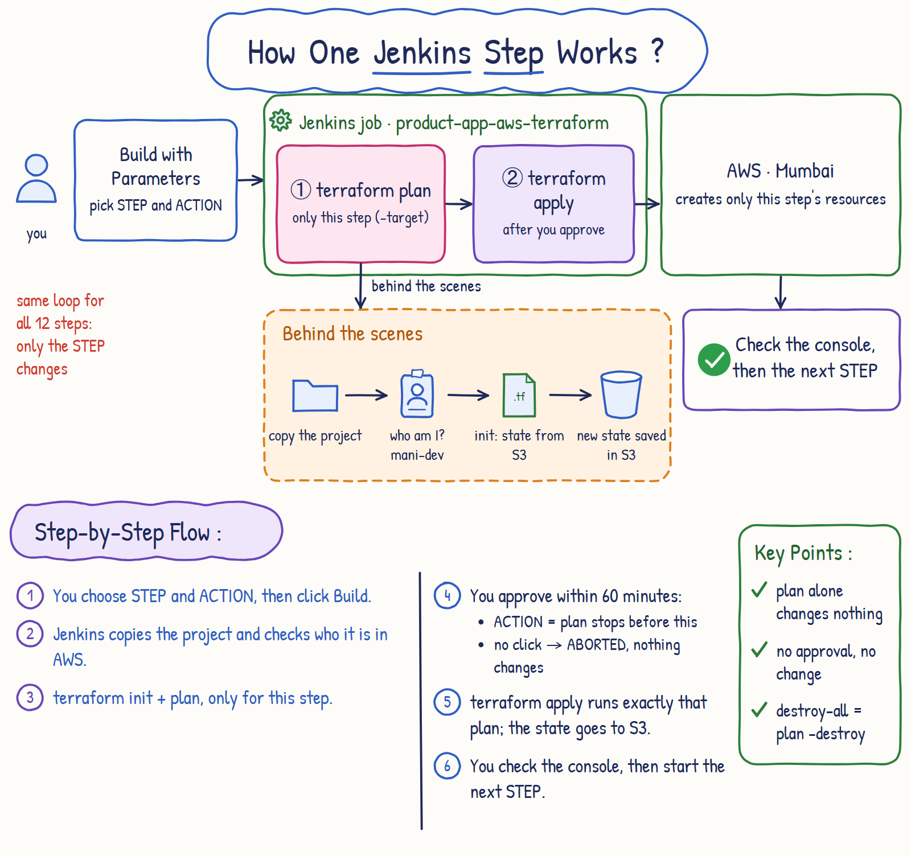

# 02 — Project structure

```
aws-dev/
├── README.md                              Start here
├── .gitignore                             Ignores target/, .env, Terraform state, backend.hcl, tfvars
├── docs/                                  This documentation
│   ├── 01-...11-*.md, 13-*.md             Step-by-step guides (start with 01)
│   ├── 12-aws-sketchbook.html             Hand-drawn boards, one per AWS step (open in a browser)
│   └── images/sketchbook-*.png            The same 14 boards as PNG images (small copies in images/thumbs/)
├── jenkins/
│   └── Jenkinsfile                        Pipeline: one build = one step of AWS resources (doc 11), plus code-quality (doc 13)
├── scripts/
│   ├── build-and-push.sh                  Build the image and push it to ECR (reads the URL from Terraform)
│   ├── redeploy.sh                        Force ECS to restart tasks with the freshly pushed image
│   ├── smoke-test.sh                      Call every endpoint and check status codes (local or through the ALB)
│   ├── jenkins-setup.sh                   Store the AWS keys (and, with --sonar-token, the SonarQube token) in Jenkins; create/update the job
│   └── sketchbook/                        generate.py + sketchbook.css: draw the sketchbook and its PNGs
├── sonarqube/                             ── LOCAL CODE QUALITY SERVER (doc 13) ──
│   ├── docker-compose.yml                 SonarQube Community Build + its PostgreSQL, health checks, volumes
│   ├── .env.example                       Template for the SonarQube database password and port (copy to .env)
│   └── .env                               Local values (git-ignored)
│
├── product-app/                           ── THE SPRING BOOT APPLICATION ──
│   ├── pom.xml                            Maven build: Spring Boot 4.2 parent, dependencies, jar name "product-app",
│   │                                      JaCoCo coverage (report + 80 % check), SonarQube scanner settings
│   ├── Dockerfile                         Multi-stage build (Maven -> layered jar -> JRE image), non-root, HEALTHCHECK
│   ├── .dockerignore                      Keeps target/, .env, docs out of the image build context
│   ├── docker-compose.yml                 MySQL + app, health checks, startup ordering, named volume
│   ├── .env.example                       Template for local credentials/ports/SonarQube token (copy to .env)
│   ├── .env                               Local values incl. SONAR_TOKEN (git-ignored)
│   ├── sonar-scan.cmd / sonar-scan.sh     Load SONAR_TOKEN from .env, run mvn clean verify sonar:sonar
│   └── src/
│       ├── main/java/com/example/productapp/
│       │   ├── ProductAppApplication.java         @SpringBootApplication entry point
│       │   ├── config/OpenApiConfig.java          Title/description shown in Swagger UI
│       │   ├── controller/ProductController.java  REST endpoints /api/products (+ OpenAPI annotations)
│       │   ├── dto/ProductRequest.java            Incoming JSON + validation rules
│       │   ├── dto/ProductResponse.java           Outgoing JSON
│       │   ├── dto/ApiErrorResponse.java          Error JSON (timestamp, status, message, path, fieldErrors)
│       │   ├── dto/ProductMapper.java             Entity <-> DTO conversion (static methods)
│       │   ├── entity/Product.java                JPA entity for table "products"
│       │   ├── repository/ProductRepository.java  JpaRepository<Product, Long>
│       │   ├── service/ProductService.java        Business logic, transactions, logging
│       │   ├── exception/ProductNotFoundException.java
│       │   └── exception/GlobalExceptionHandler.java  Maps exceptions -> HTTP status + ApiErrorResponse
│       ├── main/resources/
│       │   ├── application.yml                    Common config; reads DB_* environment variables
│       │   ├── application-local.yml              Overrides for Docker Compose
│       │   ├── application-aws.yml                Overrides for ECS Fargate
│       │   └── db/migration/
│       │       └── V1__create_products_table.sql  Flyway migration (schema version 1)
│       └── test/java/com/example/productapp/
│           ├── service/ProductServiceTest.java        Unit tests with Mockito (no Spring, no DB)
│           ├── controller/ProductControllerTest.java  @WebMvcTest: HTTP layer + error handling, service mocked
│           └── ProductApiIntegrationTest.java         @SpringBootTest + Testcontainers MySQL: Flyway + full CRUD
│
└── terraform/                             ── AWS INFRASTRUCTURE ──
    ├── versions.tf                        Terraform/provider versions, S3 backend (key, encryption, lockfile)
    ├── backend.hcl.example                Bucket + region for "terraform init -backend-config=backend.hcl"
    ├── providers.tf                       AWS provider, region, default tags
    ├── variables.tf                       All inputs with defaults (region, sizes, DB settings, HTTPS, scaling)
    ├── terraform.tfvars.example           Example overrides
    ├── deployer-iam-policy.json           IAM policy for the person who runs Terraform (doc 08, step 0)
    ├── locals.tf                          Name prefix and HTTPS decision logic
    ├── vpc.tf                             VPC, 6 subnets in 2 AZs, IGW, NAT Gateway, route tables
    ├── security_groups.tf                 ALB -> ECS -> RDS firewall chain
    ├── iam.tf                             ECS task execution role (ECR, logs, secret) and task role
    ├── ecr.tf                             Image repository + lifecycle policy
    ├── secrets.tf                         Random DB password stored in Secrets Manager
    ├── rds.tf                             RDS MySQL instance + subnet group
    ├── cloudwatch.tf                      Log group for the containers
    ├── alb.tf                             Load balancer, target group, HTTP (and HTTPS) listeners
    ├── acm.tf                             OPTIONAL certificate + DNS validation + Route 53 alias
    ├── ecs.tf                             ECS cluster + Fargate task definition (env vars, secrets, logging)
    ├── ecs_service.tf                     ECS service wired to the ALB
    ├── autoscaling.tf                     OPTIONAL CPU target-tracking auto scaling
    ├── outputs.tf                         URLs, names and ARNs printed after apply
    └── bootstrap/main.tf                  One-time S3 state bucket (versioned, encrypted, private)
```

## Which file builds which part of AWS

Everything in `terraform/` together builds this picture (each part is labelled with its step number):


| File(s) | Board |
|---|---|
| `jenkins/Jenkinsfile`, `scripts/jenkins-setup.sh` | how one step runs |
| `terraform/bootstrap/main.tf` | step 01 · S3 state bucket |
| `terraform/vpc.tf` (network part) | step 02 · VPC |
| `terraform/security_groups.tf` | step 03 · security groups |
| `terraform/iam.tf` | step 04 · IAM roles |
| `terraform/ecr.tf` | step 05 · ECR |
| `product-app/Dockerfile`, `scripts/build-and-push.sh` | step 06 · the image |
| `terraform/secrets.tf` | step 07 · Secrets Manager |
| `terraform/cloudwatch.tf` | step 08 · CloudWatch Logs |
| `terraform/rds.tf` | step 09 · RDS |
| `terraform/vpc.tf` (NAT part) | step 10 · NAT gateway |
| `terraform/alb.tf` | step 11 · load balancer |
| `terraform/ecs.tf`, `terraform/ecs_service.tf` | step 12 · ECS |

The boards, in the order Jenkins applies them ([doc 11](11-jenkins-terraform-step-by-step.md)):

### `jenkins/Jenkinsfile`, `scripts/jenkins-setup.sh`



### `terraform/bootstrap/main.tf`


### `terraform/vpc.tf` (network part)


### `terraform/security_groups.tf`


### `terraform/iam.tf`


### `terraform/ecr.tf`


### `product-app/Dockerfile`, `scripts/build-and-push.sh`


### `terraform/secrets.tf`


### `terraform/cloudwatch.tf`


### `terraform/rds.tf`


### `terraform/vpc.tf` (NAT part)


### `terraform/alb.tf`


### `terraform/ecs.tf`, `terraform/ecs_service.tf`


## Naming conventions

- Java package: `com.example.productapp` with one sub-package per layer.
- Flyway files: `V<version>__<description>.sql` (two underscores), e.g. `V2__add_sku_column.sql`.
- Terraform resources: `<project>-<environment>-<purpose>`, e.g. `product-app-dev-alb`. The prefix is
  built once in `locals.tf` (`local.name_prefix`).
- Environment variables used by the app: `SPRING_PROFILES_ACTIVE`, `DB_HOST`, `DB_PORT`, `DB_NAME`,
  `DB_USERNAME`, `DB_PASSWORD` — identical names locally and on AWS.

## Files you should never commit

`product-app/.env`, `sonarqube/.env`, `terraform/backend.hcl`, `terraform/terraform.tfvars`, `terraform/*.tfstate*`,
`terraform/.terraform/`. They are all listed in `.gitignore`. Your SonarQube token lives only in the
git-ignored `product-app/.env` or in a `SONAR_TOKEN` Windows variable (doc 13, step 4).
