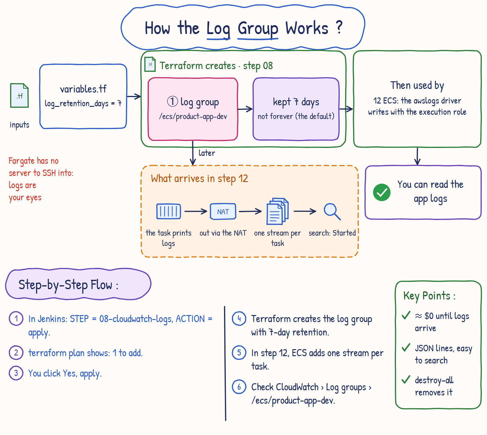

# 03 — API documentation

Base path: `/api/products`. All requests and responses are JSON (`Content-Type: application/json`).

| Method | Endpoint | Description | Success | Errors |
|---|---|---|---|---|
| POST | `/api/products` | Create a product | 201 Created (+ `Location` header) | 400 |
| GET | `/api/products` | List all products | 200 OK (array, may be empty) | – |
| GET | `/api/products/{id}` | Get one product | 200 OK | 400 (id not a number), 404 |
| PUT | `/api/products/{id}` | Update a product (full replace) | 200 OK | 400, 404 |
| DELETE | `/api/products/{id}` | Delete a product | 204 No Content | 404 |

Any unknown URL returns 404 with the standard error body; unexpected failures return 500.

## Request body (`ProductRequest`)

| Field | Type | Rules |
|---|---|---|
| `name` | string | required, not blank, max 100 characters |
| `description` | string | optional, max 500 characters |
| `price` | number | required, >= 0, max 8 integer digits and 2 decimals |
| `quantity` | integer | required, >= 0 |

## Response body (`ProductResponse`)

```json
{
  "id": 1,
  "name": "Wireless Mouse",
  "description": "Ergonomic 2.4 GHz wireless mouse",
  "price": 29.99,
  "quantity": 150,
  "createdAt": "2026-01-15T10:30:00.123456Z",
  "updatedAt": "2026-01-15T10:30:00.123456Z"
}
```

## Error body (`ApiErrorResponse`)

Every error has the same shape. `fieldErrors` only appears for validation failures.

```json
{
  "timestamp": "2026-01-15T10:30:00Z",
  "status": 400,
  "error": "Bad Request",
  "message": "Validation failed",
  "path": "/api/products",
  "fieldErrors": {
    "name": "Name is required",
    "price": "Price must be zero or positive"
  }
}
```

## Examples with curl

Create:

```bash
curl -i -X POST http://localhost:8080/api/products \
  -H "Content-Type: application/json" \
  -d '{"name":"Wireless Mouse","description":"Ergonomic 2.4 GHz wireless mouse","price":29.99,"quantity":150}'
```

```
HTTP/1.1 201
Location: http://localhost:8080/api/products/1
Content-Type: application/json

{"id":1,"name":"Wireless Mouse","description":"Ergonomic 2.4 GHz wireless mouse","price":29.99,"quantity":150,"createdAt":"...","updatedAt":"..."}
```

List, get, update, delete:

```bash
curl http://localhost:8080/api/products
curl http://localhost:8080/api/products/1
curl -X PUT http://localhost:8080/api/products/1 -H "Content-Type: application/json" \
  -d '{"name":"Wireless Mouse Pro","description":"Rechargeable","price":39.99,"quantity":80}'
curl -i -X DELETE http://localhost:8080/api/products/1        # HTTP/1.1 204
```

Validation failure (400):

```bash
curl -X POST http://localhost:8080/api/products -H "Content-Type: application/json" -d '{"name":"","price":-1}'
```

```json
{"timestamp":"...","status":400,"error":"Bad Request","message":"Validation failed","path":"/api/products",
 "fieldErrors":{"name":"Name is required","price":"Price must be zero or positive","quantity":"Quantity is required"}}
```

Not found (404):

```bash
curl http://localhost:8080/api/products/999
```

```json
{"timestamp":"...","status":404,"error":"Not Found","message":"Product not found with id: 999","path":"/api/products/999"}
```

PowerShell users: `curl` is an alias of `Invoke-WebRequest`. Use `curl.exe` instead of `curl`, or:

```powershell
Invoke-RestMethod -Method Post -Uri http://localhost:8080/api/products -ContentType "application/json" `
  -Body '{"name":"Wireless Mouse","price":29.99,"quantity":150}'
```

## Swagger UI / OpenAPI

| URL | Purpose |
|---|---|
| http://localhost:8080/swagger-ui/index.html | Interactive documentation. Expand an endpoint, click **Try it out**, edit the example body, **Execute** |
| http://localhost:8080/v3/api-docs | Raw OpenAPI 3 JSON (import into Postman, generate clients, ...) |

### How the documentation is generated

- `springdoc-openapi-starter-webmvc-ui` scans the controllers at startup.
- `config/OpenApiConfig.java` provides the title, version and description.
- `@Tag`, `@Operation`, `@ApiResponses` on `ProductController` document each endpoint and its status codes;
  `@ExampleObject` supplies the 400 and 404 example bodies.
- `@Schema(description, example)` on the DTO record components produce the request/response examples
  and field descriptions. The validation annotations (`@Size`, `@Min`, ...) are also reflected in the schema.

### Verify

1. Open Swagger UI, the page title must read **Product App API 1.0.0**.
2. `POST /api/products` → **Try it out** → **Execute** with the pre-filled example → response code 201.
3. `GET /api/products/{id}` with id `999` → response code 404 with the error body.

## Health and operational endpoints (Actuator)

| URL | Purpose |
|---|---|
| `/actuator/health` | Overall status, used by Docker, ECS and the ALB. Local profile shows components (db) |
| `/actuator/health/liveness` | Is the JVM alive? (Kubernetes-style probe) |
| `/actuator/health/readiness` | Can the app take traffic? |
| `/actuator/info` | Empty by default; add `info.*` properties if needed |

Only `health` and `info` are exposed (`management.endpoints.web.exposure.include`).

On AWS two callers use `/actuator/health` all the time:

### The load balancer: every 30 s, 2 × 200 = healthy, 3 failures = no more traffic


### ECS: the container health check (90 s start period)


## Calling the API on AWS

On AWS the same endpoints sit behind the load balancer. Replace `http://localhost:8080` with
`http://<alb-dns-name>` (from `terraform output app_url`):

```bash
ALB=http://<alb-dns-name>
curl $ALB/api/products
curl -i -X POST $ALB/api/products -H "Content-Type: application/json" \
  -d '{"name":"Cloud Mouse","price":19.99,"quantity":5}'
./scripts/smoke-test.sh $ALB        # the same 12 checks as locally, ends with ALL CHECKS PASSED
```

| | Local (Docker Compose) | AWS |
|---|---|---|
| Base URL | `http://localhost:8080` | `http://<alb-dns-name>` (port 80; HTTPS only when a certificate is configured) |
| Swagger UI | `/swagger-ui/index.html` | the same path on the load balancer; `Location` headers use the load balancer host |
| `/actuator/health` | shows the components (`db`, `diskSpace`, ...) | only `{"groups":["liveness","readiness"],"status":"UP"}` (the `aws` profile hides details) |
| Error details | `docker compose logs app` | CloudWatch Logs `/ecs/product-app-dev`, one JSON line per log entry |

Where a request goes once it reaches AWS:


### The path of one request

#### Only the load balancer may call the app on 8080; only the app may call MySQL


#### POST, PUT and DELETE write to RDS MySQL


#### The app's database login comes from Secrets Manager


#### 400, 404 and 500 errors are logged to CloudWatch



### Behind the scenes

Not part of the API, but needed for it to answer at all:

#### The private network the API runs in


#### The way out for image pulls, secrets and logs


#### Where the API image is stored ...


#### ... and how it gets there


#### No AWS keys inside the API container


#### Terraform's memory of all of this


#### Built step by step by Jenkins


