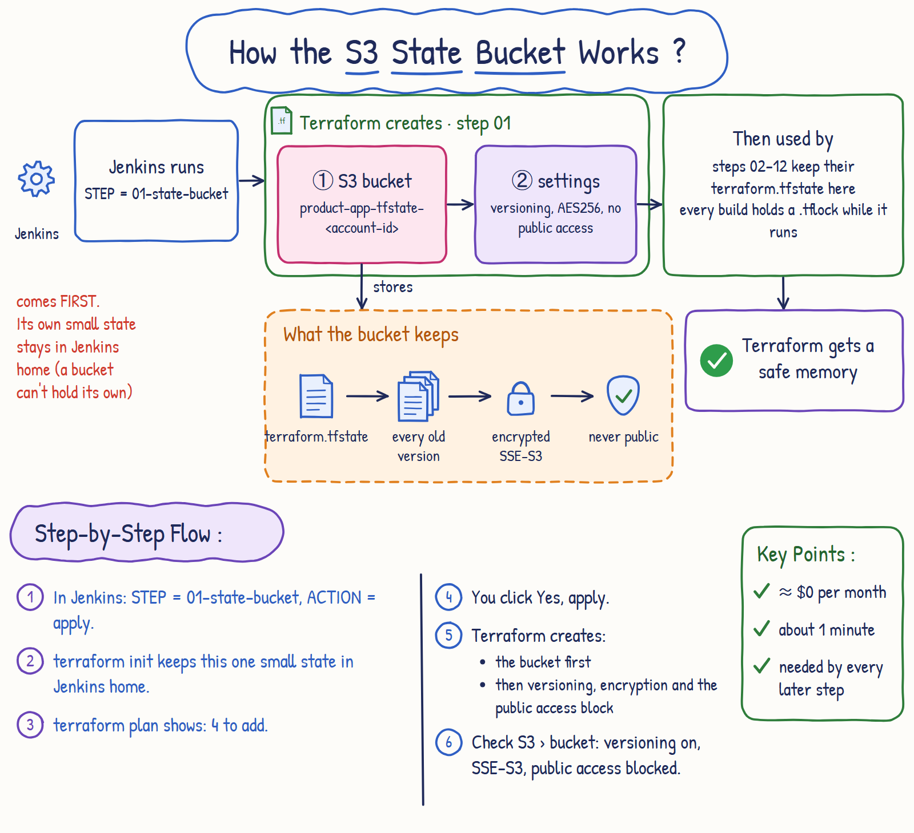

# 04 — Database migrations with Flyway

## 1. What are we implementing?

Versioned SQL scripts that create and evolve the MySQL schema. Flyway runs them automatically
when the Spring Boot application starts, in both Docker Compose and AWS.

On AWS, Flyway runs inside the ECS task and migrates the RDS database (the boxes "ECS task" and
"RDS MySQL" in this picture):


## 2. Why do we need it?

- **Repeatable**: every environment (your laptop, a colleague's laptop, RDS on AWS) gets exactly the
  same tables, in the same order.
- **Tracked**: Flyway records what was applied in the table `flyway_schema_history`, so a script is
  never run twice and a missing one is detected.
- **Safe**: `spring.jpa.hibernate.ddl-auto=validate` means Hibernate only *checks* that the entity
  matches the table. It never creates or alters tables on its own (`update` can silently produce
  wrong column types and cannot drop or rename anything, which is why it is not used).

## 3. How does it work?

```
app starts
  └─► Flyway connects with DB_USERNAME/DB_PASSWORD
        ├─► creates flyway_schema_history if missing
        ├─► lists classpath:db/migration/V*.sql, sorts by version
        ├─► runs every version not yet in the history table (each in its own transaction)
        └─► records version, description, checksum, success
  └─► Hibernate validates entities against the tables (ddl-auto=validate)
  └─► Tomcat starts listening on 8080
```

If a migration fails, the application **does not start**. That is intentional: a half-migrated
database must never serve traffic.

On AWS the same start-up happens inside the ECS task. In the board's orange strip "When the task starts",
Flyway is the third picture, after the image is pulled and the password is read:

### Where Flyway runs on AWS: the ECS task start-up


Why a failed migration never serves traffic: the load balancer only forwards requests once
`/actuator/health` answers 200, and the app only answers after Flyway succeeded.

### The load balancer waits for a healthy task


## 4. Which configuration files are involved?

| File | Content |
|---|---|
| `pom.xml` | `spring-boot-starter-flyway` + `flyway-mysql` (MySQL support module, required since Flyway 10) |
| `application.yml` | `spring.flyway.enabled=true`, `spring.flyway.locations=classpath:db/migration`, `spring.jpa.hibernate.ddl-auto=validate` |
| `src/main/resources/db/migration/V1__create_products_table.sql` | The first migration |

Naming rule: `V<version>__<description>.sql` — capital V, version number, **two** underscores,
description with single underscores. Examples: `V1__create_products_table.sql`, `V2__add_sku_to_products.sql`,
`V2.1__fix_index.sql`.

Flyway logs in with `DB_USERNAME` / `DB_PASSWORD`. Locally they come from `.env`; on AWS from
Secrets Manager, read by the ECS execution role:

### `DB_USERNAME` / `DB_PASSWORD` on AWS: Secrets Manager


### The execution role may read that one secret


## 5. What commands should I execute?

Nothing extra: migrations run on application start. To watch them:

```bash
docker compose logs app | grep -i flyway
```

To inspect the history table inside the local MySQL container:

```bash
docker compose exec mysql mysql -uproduct_user -pproduct_pass productdb \
  -e "SELECT installed_rank, version, description, success, installed_on FROM flyway_schema_history;"
docker compose exec mysql mysql -uproduct_user -pproduct_pass productdb -e "SHOW CREATE TABLE products\G"
```

(Use the values from your `.env` file.)

## 6. What output should I expect?

Application log on first start:

```
o.f.c.i.database.base.BaseDatabaseType   : Database: jdbc:mysql://mysql:3306/productdb (MySQL 8.0)
o.f.core.internal.command.DbValidate     : Successfully validated 1 migration (execution time 00:00.01s)
o.f.c.i.s.JdbcTableSchemaHistory         : Creating Schema History table `productdb`.`flyway_schema_history` ...
o.f.core.internal.command.DbMigrate      : Current version of schema `productdb`: << Empty Schema >>
o.f.core.internal.command.DbMigrate      : Migrating schema `productdb` to version "1 - create products table"
o.f.core.internal.command.DbMigrate      : Successfully applied 1 migration to schema `productdb`, now at version v1
```

On every later start:

```
o.f.core.internal.command.DbMigrate      : Current version of schema `productdb`: 1
o.f.core.internal.command.DbMigrate      : Schema `productdb` is up to date. No migration necessary.
```

History table:

```
+----------------+---------+-----------------------+---------+---------------------+
| installed_rank | version | description           | success | installed_on        |
+----------------+---------+-----------------------+---------+---------------------+
|              1 | 1       | create products table |       1 | 2026-11-22 10:30:00 |
+----------------+---------+-----------------------+---------+---------------------+
```

## 7. How can I verify it?

- Locally: the queries above, or the integration test `ProductApiIntegrationTest.flywayMigrationWasApplied`
  (`mvn test`), which asserts that `flyway_schema_history` has a successful row and that `products` exists.
- On AWS: CloudWatch log group `/ecs/product-app-dev` shows the same Flyway lines on task start. RDS is not
  reachable from the internet, so there is no direct `mysql` client access by design.

### Flyway lines on AWS: CloudWatch Logs


### The database Flyway migrates: RDS MySQL 8.4


### Why there is no direct `mysql` access: security groups ...


### ... and private DB subnets with no internet route


## 8. Common errors and solutions

| Error (in the app log) | Cause | Solution |
|---|---|---|
| `Migration checksum mismatch for migration version 1` | A migration file was edited after it was applied | Never edit applied migrations. Revert the file and add a new `V2__...sql`. In dev only you can wipe the volume: `docker compose down -v` |
| `Detected resolved migration not applied to database: 2` | A new file exists but the DB is ahead/behind (usually after switching branches) | Start the app so it applies it; in dev, `docker compose down -v` to reset |
| `No database found to handle jdbc:mysql://...` | `flyway-mysql` dependency missing | It is in `pom.xml`; rebuild the image |
| `Access denied for user` | Wrong `DB_USERNAME` / `DB_PASSWORD` | Check `.env` (local) or the Secrets Manager secret (AWS) |
| `Schema-validation: missing table [products]` | Flyway disabled, wrong `locations`, or file not under `db/migration` | Check `application.yml` and the file path |
| `Unknown collation: utf8mb4_0900_ai_ci` | Using MySQL 5.7 instead of 8 | Use MySQL 8 (Docker Compose `mysql:8.0.46`, Testcontainers `mysql:8.0.46`, RDS engine 8.4) |

## Adding a new migration (example)

1. Create `src/main/resources/db/migration/V2__add_sku_to_products.sql`:

   ```sql
   ALTER TABLE products ADD COLUMN sku VARCHAR(50) NULL AFTER name;
   CREATE UNIQUE INDEX uk_products_sku ON products (sku);
   ```

2. Add the field to `Product.java` (`@Column(length = 50) private String sku;`) and to the DTOs.
3. `mvn test` — the integration test applies V1 and V2 on a fresh MySQL and validates the entity.
4. `docker compose up -d --build` — the running local database receives only V2.
5. Build, push and redeploy the image on AWS (see [08-aws-deployment-steps.md](08-aws-deployment-steps.md));
   the ECS task applies V2 to RDS on start.

Rules: migrations must be **backwards compatible with the currently running version** when you
deploy without downtime (add columns as NULL or with defaults; drop columns only after no code uses them).

### Shipping a new migration to AWS

A new `V2__...sql` reaches RDS inside the image: build it, push it, and let ECS start a task with it.

#### 1 · The new image, with V2 inside


#### 2 · Stored in ECR


#### 3 · Pulled by the new task through the NAT gateway


#### 4 · With Jenkins: steps 06 and 12 again


#### 5 · With a new tag, Terraform records the new task definition in its state


