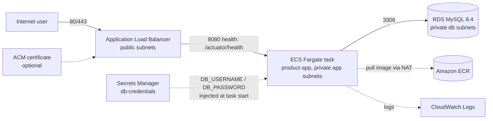
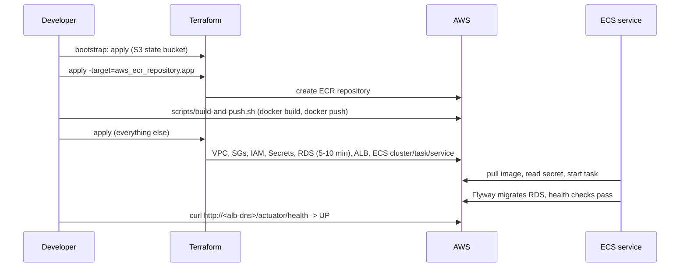

# 06 — AWS architecture

## 1. What are we implementing?

A private, load-balanced deployment of the same Docker image on **ECS Fargate**, backed by
**RDS MySQL**, inside a **dedicated VPC**, with credentials in **Secrets Manager** and logs in
**CloudWatch**. Everything is created by Terraform.

The finished system, drawn by hand (each part is labelled with the step that creates it, see the
[sketchbook](12-aws-sketchbook.html)). The text diagram below shows the same thing in more detail.


```
                                   ┌──────────────────────────── VPC 10.0.0.0/16 (region ap-south-1) ────────────────────────────┐
                                   │                                                                                               │
                                   │   AZ a                                             AZ b                                       │
                                   │  ┌──────────────────────────────┐                ┌──────────────────────────────┐             │
   Internet                        │  │ public subnet 10.0.0.0/24    │                │ public subnet 10.0.1.0/24    │             │
      │                            │  │  ┌─────────┐   ┌───────────┐ │                │  ┌─────────┐                 │             │
      │  HTTP 80 / HTTPS 443       │  │  │   ALB   │   │  NAT GW   │ │                │  │   ALB   │ (2nd node)      │             │
      └────────────────────────────┼──┼─►│         │   │ + EIP     │ │                │  │         │                 │             │
                                   │  │  └────┬────┘   └─────▲─────┘ │                │  └────┬────┘                 │             │
                                   │  └───────┼──────────────┼───────┘                └───────┼──────────────────────┘             │
                                   │          │ 8080         │ outbound only                  │                                    │
                                   │  ┌───────▼──────────────┼───────┐                ┌───────▼──────────────────────┐             │
                                   │  │ private app 10.0.10.0/24     │                │ private app 10.0.11.0/24     │             │
                                   │  │  ┌───────────────────┴─────┐ │                │  (tasks are placed in either │             │
                                   │  │  │ ECS Fargate task        │ │                │   AZ; 1 task by default)     │             │
                                   │  │  │ product-app:8080        │ │                │                              │             │
                                   │  │  │ profile=aws             │ │                │                              │             │
                                   │  │  └───────────┬─────────────┘ │                │                              │             │
                                   │  └──────────────┼───────────────┘                └──────────────────────────────┘             │
                                   │                 │ 3306                                                                        │
                                   │  ┌──────────────▼───────────────┐                ┌──────────────────────────────┐             │
                                   │  │ private db 10.0.20.0/24      │                │ private db 10.0.21.0/24      │             │
                                   │  │  ┌─────────────────────────┐ │                │  (standby lives here when    │             │
                                   │  │  │ RDS MySQL 8.4           │ │                │   db_multi_az = true)        │             │
                                   │  │  │ db.t4g.micro, no public │ │                │                              │             │
                                   │  │  └─────────────────────────┘ │                │                              │             │
                                   │  └──────────────────────────────┘                └──────────────────────────────┘             │
                                   │     (no route to the internet at all)                                                         │
                                   └───────────────────────────────────────────────────────────────────────────────────────────────┘

   Regional services used by the task (reached through the NAT Gateway):
     Amazon ECR  ─ image "product-app:latest"        AWS Secrets Manager ─ product-app-dev/db-credentials {username, password}
     CloudWatch Logs ─ /ecs/product-app-dev          IAM ─ task execution role (pull image, write logs, read secret) + task role
     ACM (optional) ─ TLS certificate for the ALB    S3 ─ Terraform state bucket (with lockfile)
```

Mermaid version (renders on GitHub / VS Code):



## 2. Why each service?

| Service | Role in this project | Why not something else |
|---|---|---|
| **VPC** (own, not default) | Isolated network with public/private tiers | The default VPC has only public subnets; isolation is a security requirement |
| **Public subnets** (2 AZs) | Host the ALB nodes and the NAT Gateway | An ALB requires at least two AZs |
| **Private app subnets** | Host the ECS tasks; no public IP | Tasks cannot be reached directly from the internet |
| **Private db subnets** | Host RDS; **no internet route at all** | Even a misconfigured security group cannot expose the database |
| **Internet Gateway** | Internet access for the public subnets | |
| **NAT Gateway** | Lets private tasks reach ECR, CloudWatch, Secrets Manager outbound | Tasks need to pull the image and send logs; VPC endpoints are an alternative (see 09) |
| **ALB** | Single public entry point, health checks, HTTPS termination | Replaces exposing the task directly; required for scaling to several tasks |
| **ECS Fargate** | Runs the container without managing servers | No EC2 patching; pay per task |
| **ECR** | Private registry for the image | ECS pulls from it with the execution role; images are scanned on push |
| **RDS MySQL** | Managed database: backups, patching, optional Multi-AZ | Running MySQL in a container on Fargate would lose data on restart |
| **Secrets Manager** | Stores the generated DB password; ECS injects it as env var | The password never appears in the task definition, image or code |
| **IAM** | Execution role (ECR + logs + secret) and task role (app permissions) | Least privilege: each role has only what it needs |
| **CloudWatch Logs** | Container stdout/stderr, 7-day retention | Only way to see application logs on Fargate |
| **ACM** | Free TLS certificate for the ALB (optional) | Needs a domain you control |
| **S3** | Terraform remote state with native lockfile | Shared, versioned state; prevents two people applying at once |

### Each service up close

One board per service, in the order Terraform builds them. Each board shows what the service needs
first, what Terraform creates and in which order, what uses it later, and how it works inside.
The numbers are the step numbers of the Jenkins guide ([doc 11](11-jenkins-terraform-step-by-step.md)).

#### 01 · S3 state bucket


#### 02 · VPC, subnets and route tables


#### 03 · Security groups


#### 04 · IAM roles


#### 05 · ECR repository


#### 06 · The image in ECR


#### 07 · Secrets Manager


#### 08 · CloudWatch Logs


#### 09 · RDS MySQL


#### 10 · NAT gateway


#### 11 · Application Load Balancer


#### 12 · ECS on Fargate


## 3. How does traffic flow?

**Inbound request** `GET http://<alb-dns>/api/products`

1. DNS resolves the ALB name to its public IPs (one per AZ).
2. The ALB security group allows 80 (and 443) from `0.0.0.0/0`.
3. The listener forwards to the target group (`target_type = ip`, port 8080).
4. The ECS security group allows 8080 **only from the ALB security group**.
5. Spring Boot handles the request; `server.forward-headers-strategy=framework` makes generated URLs
   use the public scheme/host.

**Task start-up**

1. ECS assumes the **execution role**, pulls `product-app:<tag>` from ECR (through the NAT Gateway),
   reads `username` and `password` from the secret and injects them as `DB_USERNAME`/`DB_PASSWORD`.
2. The container starts with `SPRING_PROFILES_ACTIVE=aws`, `DB_HOST=<rds endpoint>`, `DB_PORT=3306`, `DB_NAME=productdb`.
3. Flyway connects to RDS (RDS security group allows 3306 only from the ECS security group) and applies
   pending migrations.
4. The container health check and the ALB health check hit `/actuator/health`. After 2 successful checks
   the task receives traffic.
5. Logs stream to CloudWatch log group `/ecs/product-app-dev`, stream `ecs/product-app/<task id>`.

## 4. Security model (what is enforced where)

| Requirement | Implemented by |
|---|---|
| ALB in public subnets | `alb.tf` → `subnets = aws_subnet.public[*].id` |
| ECS tasks in private subnets, no public IP | `ecs_service.tf` → `assign_public_ip = false`, private app subnets |
| RDS in private DB subnets, not public | `rds.tf` → `publicly_accessible = false`, DB subnet group over `private_db` |
| DB access only from ECS | `security_groups.tf` → `rds_from_ecs` rule references the ECS SG; no other ingress |
| DB subnets have no internet route | `vpc.tf` → `aws_route_table.private_db` has no `0.0.0.0/0` route |
| Credentials in Secrets Manager | `secrets.tf`, injected via `secrets` in `ecs.tf` |
| Least privilege IAM | `iam.tf` → execution role: managed ECS policy + `GetSecretValue` on **one** secret ARN; task role: empty |
| HTTPS | `acm.tf` + `alb.tf` HTTPS listener and HTTP→HTTPS redirect when a certificate is configured |
| Encryption at rest | RDS `storage_encrypted = true`, S3 state bucket SSE, Secrets Manager (always encrypted) |
| Non-root container | `Dockerfile` → `USER app` |

## 5. Deployment flow

With Jenkins, the same flow runs as a loop of small steps, one group of resources per build
([doc 11](11-jenkins-terraform-step-by-step.md)):


Done by hand with Terraform, as in [doc 08](08-aws-deployment-steps.md):



The ECR repository is created first because the ECS service needs an image to exist before its first
task can start. See [08-aws-deployment-steps.md](08-aws-deployment-steps.md).

## 6. High availability as configured (demo sizing)

| Component | Now | Production upgrade |
|---|---|---|
| ECS tasks | 1 task, can be placed in either AZ | `desired_count = 2+`, `enable_autoscaling = true` |
| ALB | Already spans 2 AZs | – |
| NAT Gateway | 1 (AZ a); if AZ a fails, tasks in AZ b lose outbound access | One NAT per AZ |
| RDS | Single AZ, 1-day backups | `db_multi_az = true`, 7+ day backups, deletion protection |

Details and costs: [09-scaling-and-cost.md](09-scaling-and-cost.md).
