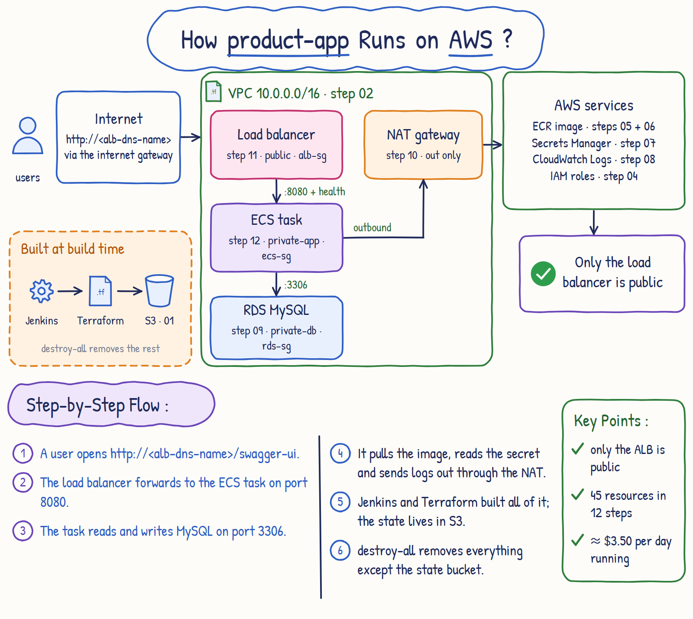
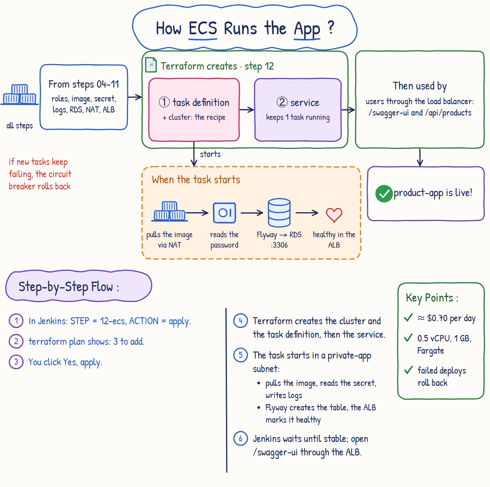

# 07 — Terraform implementation

## 1. What are we implementing?

All AWS infrastructure for product-app as code, in the `terraform/` folder, with **one file per
concern** so each file stays short and readable. A second tiny configuration in `terraform/bootstrap/`
creates the S3 bucket that stores the state.

What this code builds, drawn by hand (each part is labelled with the step that creates it, see the
[sketchbook](12-aws-sketchbook.html)):



## 2. Why Terraform (and why remote state)?

- The whole environment can be created, changed and **destroyed** with one command. No clicking.
- The configuration is reviewed like code and reused for other environments (`environment = "staging"`).
- **Remote state in S3** means the state file (which records what exists) is shared, versioned and
  backed up. The **native S3 lockfile** (`use_lockfile = true`) prevents two `apply` runs at the same
  time without needing a DynamoDB table.

## 3. How does it work? (file by file)

| File | Creates | Notes |
|---|---|---|
| `versions.tf` | – | Terraform ≥ 1.10, AWS provider 6.x, `random` provider, `backend "s3"` with `key`, `encrypt`, `use_lockfile` |
| `backend.hcl.example` | – | Bucket + region, passed with `-backend-config`. Copy to `backend.hcl` |
| `deployer-iam-policy.json` | – | Not Terraform code. The IAM policy the deploying user needs; an admin attaches it (doc 08, step 0) |
| `providers.tf` | – | Region from a variable, `default_tags` on every resource (`Project`, `Environment`, `ManagedBy`) |
| `variables.tf` | – | Every input with a default. Nothing secret here |
| `locals.tf` | – | `name_prefix` (`product-app-dev`) and the HTTPS decision (`https_enabled`, `create_certificate`) |
| `vpc.tf` | VPC, 2 public + 2 private-app + 2 private-db subnets, IGW, EIP + NAT Gateway, 3 route tables + associations | DB route table has no internet route |
| `security_groups.tf` | 3 security groups + rules | Uses `aws_vpc_security_group_ingress_rule` resources (one rule each, easy to read) |
| `iam.tf` | Execution role (+ managed policy + inline secret policy), task role | `jsonencode` keeps policies readable |
| `ecr.tf` | Repository + lifecycle policy (keep 10 images) | `force_delete = true` so destroy works |
| `secrets.tf` | `random_password` + secret + secret version (JSON `{username,password}`) | `recovery_window_in_days = 0` in dev |
| `rds.tf` | DB subnet group + MySQL 8.4 instance | Encrypted, private, gp3, `apply_immediately` |
| `cloudwatch.tf` | Log group `/ecs/product-app-dev` | 7-day retention |
| `alb.tf` | ALB, target group (ip, `/actuator/health`), HTTP listener (forward or redirect), HTTPS listener (conditional) | |
| `acm.tf` | Certificate, DNS validation records, validation waiter, Route 53 alias | Only when `domain_name` + `route53_zone_id` are set |
| `ecs.tf` | Cluster + task definition | Env vars + secrets + awslogs + container health check |
| `ecs_service.tf` | Service (1 task, private subnets, attached to the target group) | Circuit breaker with rollback |
| `autoscaling.tf` | Scaling target + CPU policy | Only when `enable_autoscaling = true` |
| `outputs.tf` | URLs, names, ARNs | `terraform output app_url` |
| `bootstrap/main.tf` | S3 state bucket (versioned, encrypted, public access blocked) | Keeps its own local state |

### Each file, drawn

The same files as pictures, in the order Terraform creates their resources. Each board shows what the
file needs from other files, which resources it creates in which order (① ②), and what uses them later.
The step numbers are those of the Jenkins guide ([doc 11](11-jenkins-terraform-step-by-step.md)), which
applies the files one group at a time with `-target`.

#### `bootstrap/main.tf` · S3 state bucket (step 01)


#### `vpc.tf` · VPC, subnets, internet gateway, route tables (step 02)


#### `security_groups.tf` · 3 groups + 5 rules (step 03)


#### `iam.tf` · execution role + task role (step 04)


#### `ecr.tf` · repository + lifecycle policy (step 05)


#### Not a `.tf` file · the image the task definition points at (step 06)


#### `secrets.tf` + the inline policy in `iam.tf` (step 07)


#### `cloudwatch.tf` · log group (step 08)


#### `rds.tf` · DB subnet group + MySQL instance (step 09)


#### `vpc.tf` again · Elastic IP, NAT gateway, private-app route table (step 10)


#### `alb.tf` · load balancer, target group, listener (step 11)


#### `ecs.tf` + `ecs_service.tf` · cluster, task definition, service (step 12)



### How files reference each other

Terraform figures out the order automatically from references, for example:

```
aws_ecs_task_definition.app  →  aws_ecr_repository.app.repository_url
                             →  aws_db_instance.mysql.address
                             →  aws_secretsmanager_secret.db.arn
                             →  aws_cloudwatch_log_group.app.name
aws_ecs_service.app          →  aws_lb_target_group.app.arn, depends_on aws_lb_listener.http
```

So RDS, the secret and the log group are created before the task definition, and the ALB listener
before the service.

### Conditional resources (the only "advanced" pattern used)

```hcl
resource "aws_lb_listener" "https" {
  count = local.https_enabled ? 1 : 0     # 1 copy when HTTPS is on, 0 copies otherwise
  ...
}
```

`count = condition ? 1 : 0` creates a resource only when needed. Referencing it elsewhere uses
`resource.name[0]` or `one(resource.name[*].attr)` (returns `null` when there is no copy).

## 4. Which configuration files do I edit?

- To change sizes, region, DB settings, HTTPS, scaling: `terraform.tfvars` (copy from `terraform.tfvars.example`).
  Defaults live in `variables.tf`.
- To point at your state bucket: `backend.hcl` (copy from `backend.hcl.example`).
- Credentials: never in files. Use `AWS_PROFILE` (or `AWS_ACCESS_KEY_ID`/`AWS_SECRET_ACCESS_KEY`) in your shell.

## 5. What commands should I execute?

These are the commands to run Terraform by hand. Jenkins runs the very same commands for you, one step
at a time and with an approval before each `apply` ([doc 11](11-jenkins-terraform-step-by-step.md)):


Set credentials for the shell session first:

```bash
export AWS_PROFILE=your-profile          # Git Bash / macOS / Linux
```
```powershell
$env:AWS_PROFILE = "your-profile"        # PowerShell
```

### One time: create the state bucket

```bash
cd terraform/bootstrap
terraform init
terraform apply -var="state_bucket_name=product-app-tfstate-<your-account-id>"
```

### Main configuration

```bash
cd terraform
cp backend.hcl.example backend.hcl        # edit: bucket name from the bootstrap output, region
cp terraform.tfvars.example terraform.tfvars   # optional: edit values

terraform init -backend-config=backend.hcl   # downloads providers, connects to the S3 backend
terraform fmt -recursive                      # formats *.tf files (run before committing)
terraform validate                            # syntax and reference check (no AWS calls)
terraform plan -out=tfplan                    # shows what WILL be created/changed; saves the plan
terraform apply tfplan                        # creates it (10-15 minutes, RDS is the slowest)
terraform output                              # URLs and names
terraform destroy                             # removes everything (asks for confirmation)
```

Useful extras:

```bash
terraform plan -var="image_tag=v2"            # override one variable for this run
terraform apply -target=aws_ecr_repository.app   # create only the ECR repo (used before the first push)
terraform state list                          # what Terraform manages
terraform show                                # full current state
terraform output -raw app_url                 # single value without quotes (for scripts)
```

## 6. What output should I expect?

`terraform init -backend-config=backend.hcl`:

```
Initializing the backend...
Successfully configured the backend "s3"! Terraform will automatically use this backend unless the backend configuration changes.
Initializing provider plugins...
- Installing hashicorp/aws v6.x ...
- Installing hashicorp/random v3.x ...
Terraform has been successfully initialized!
```

`terraform validate`:

```
Success! The configuration is valid.
```

`terraform plan` (HTTP only, no autoscaling) ends with:

```
Plan: 45 to add, 0 to change, 0 to destroy.
```

`terraform apply` ends with the outputs, for example:

```
Apply complete! Resources: 45 added, 0 changed, 0 destroyed.

Outputs:
alb_dns_name         = "product-app-dev-alb-1234567890.ap-south-1.elb.amazonaws.com"
app_url              = "http://product-app-dev-alb-1234567890.ap-south-1.elb.amazonaws.com"
cloudwatch_log_group = "/ecs/product-app-dev"
db_secret_arn        = "arn:aws:secretsmanager:ap-south-1:123456789012:secret:product-app-dev/db-credentials-AbC123"
ecr_repository_url   = "123456789012.dkr.ecr.ap-south-1.amazonaws.com/product-app"
ecs_cluster_name     = "product-app-dev-cluster"
ecs_service_name     = "product-app-dev-service"
health_url           = "http://product-app-dev-alb-1234567890.ap-south-1.elb.amazonaws.com/actuator/health"
rds_endpoint         = "product-app-dev-mysql.abcdefgh.ap-south-1.rds.amazonaws.com:3306"
swagger_url          = "http://product-app-dev-alb-1234567890.ap-south-1.elb.amazonaws.com/swagger-ui/index.html"
```

## 7. How can I verify it?

- `terraform plan` after an apply shows `No changes. Your infrastructure matches the configuration.`
- `aws s3 ls s3://<bucket>/product-app/dev/` shows `terraform.tfstate` (and briefly `terraform.tfstate.tflock` during a run).
- The AWS console → VPC, ECS, RDS, EC2 → Load Balancers show resources tagged `Project=product-app`.

## 8. Common errors and solutions

| Error | Cause | Solution |
|---|---|---|
| `Error: No valid credential sources found` | `AWS_PROFILE`/keys not set in this shell | Export the profile; test with `aws sts get-caller-identity` |
| `AccessDenied` / `not authorized to perform: ec2:CreateVpc` | IAM user lacks permissions | Your user needs rights for EC2/VPC, ECS, ECR, RDS, IAM, Secrets Manager, CloudWatch Logs, ELB, S3 (and ACM/Route 53 for HTTPS). For learning, `AdministratorAccess` or `PowerUserAccess` + `IAMFullAccess` is typical |
| `Backend initialization required` / `Backend configuration changed` | You switched backend settings | `terraform init -reconfigure -backend-config=backend.hcl` |
| `Error acquiring the state lock` | Another apply is running, or one crashed | Wait; if it crashed: `terraform force-unlock <ID>` |
| `BucketAlreadyExists` in bootstrap | S3 names are global | Pick a more unique `state_bucket_name` |
| `InvalidParameterCombination: ... db.t4g.micro ... 8.4` | Instance class/engine version not available in your region | Set `db_instance_class = "db.t3.micro"` or another supported class |
| `You can't delete the secret because a secret with that name is scheduled for deletion` | A previous destroy with a recovery window | Keep `secret_recovery_window_days = 0` in dev, or wait/force-delete the secret |
| Task definition keeps `latest` but nothing changes after push | Same tag, ECS does not re-pull automatically | `scripts/redeploy.sh` (force new deployment) or use a new tag |
| `RepositoryNotEmptyException` on destroy | Images in ECR | Already handled by `force_delete = true` |

## Changing the environment

Because every name includes `local.name_prefix`, a second environment is just a second state key
and a different `environment` value:

```bash
terraform init -backend-config=backend.hcl -backend-config="key=product-app/staging/terraform.tfstate" -reconfigure
terraform apply -var="environment=staging"
```

(Keep separate `terraform.tfvars` files per environment, e.g. `-var-file=staging.tfvars`.)
