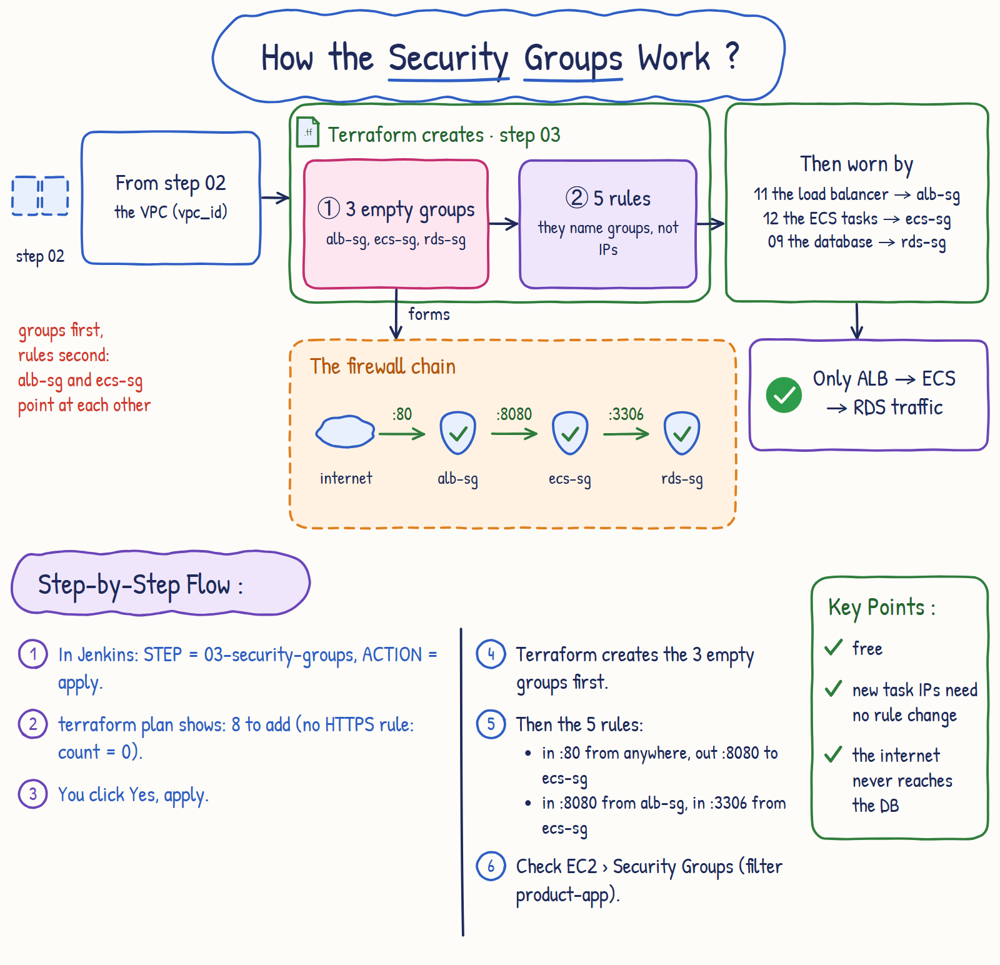

# 08 — AWS deployment steps

This is the exact order of commands to go from a working local stack to the application running on
ECS Fargate with RDS MySQL. Expected durations: bootstrap 1 min, first `apply` 10–15 min (RDS is the
slowest), image push 2–5 min.

> Status note: on 2026-11-22 this same Terraform code was applied through Jenkins, one step at a time
> ([doc 11](11-jenkins-terraform-step-by-step.md)): the app ran on ECS behind the load balancer, a full
> `terraform plan` reported *No changes*, and everything was destroyed again afterwards. The commands
> below are the manual equivalent; they need the permissions listed in step 0.

> **Prefer Jenkins?** [11-jenkins-terraform-step-by-step.md](11-jenkins-terraform-step-by-step.md) runs
> the same Terraform code from Jenkins in 13 small steps, with an approval before each change and a
> console checklist after it. Step 0 below (permissions) applies to both ways.

Where you will end up: every part is labelled with the step number it has in the Jenkins guide (doc 11).


## 0. Prerequisites

| Requirement | Check |
|---|---|
| AWS account + IAM user/role with enough permissions (see below) | `aws sts get-caller-identity` |
| AWS CLI v2 configured (`aws configure --profile <name>`) | `aws configure list-profiles` |
| Terraform ≥ 1.10 | `terraform -version` |
| Docker Desktop running | `docker info` |
| Local stack verified (doc 05) | `docker compose ps` |

**IAM permissions needed by the deploying user.** For a personal learning account the simplest option
is the AWS managed policy `AdministratorAccess`. For anything stricter, ask your AWS administrator to
attach [terraform/deployer-iam-policy.json](../terraform/deployer-iam-policy.json). It contains exactly
what this project needs, and nothing else:

| Statement | Why Terraform needs it |
|---|---|
| `ec2`, `elasticloadbalancing`, `ecs`, `ecr`, `rds`, `secretsmanager`, `logs`, `application-autoscaling` | Create and delete the VPC, ALB, ECS, ECR, RDS, secret and log group. Limited to region `ap-south-1` |
| `cloudwatch` alarm actions | The optional auto scaling policy creates CloudWatch alarms for you |
| IAM role actions on `product-app-*` only | Create the two ECS roles, tag them (default tags) and attach their policies |
| `iam:PassRole` to `ecs-tasks.amazonaws.com` only | Registering the task definition hands the two roles to ECS |
| `iam:CreateServiceLinkedRole` for ECS, ELB, RDS, auto scaling | A brand-new account has no service-linked roles yet. Each service creates its own on first use, as the caller |
| `s3:*` on `product-app-tfstate-*` only | The bootstrap bucket and the state file with its lockfile |
| `acm:*` and Route 53 record changes | Only for the optional HTTPS setup |

The administrator creates it once and attaches it to your IAM user (replace the two placeholders; the same commands work in Git Bash and PowerShell):

```bash
aws iam create-policy --policy-name product-app-deployer --policy-document file://terraform/deployer-iam-policy.json
aws iam attach-user-policy --user-name <your-iam-user> --policy-arn arn:aws:iam::<account-id>:policy/product-app-deployer
```

> If you deploy to another region, change `ap-south-1` in the policy as well as `aws_region` in
> `terraform.tfvars`. Note that anyone who can create IAM roles and pass them to ECS can, in effect,
> give an ECS task more power than they have themselves. That is acceptable for a dev account; in a
> shared company account your administrator would add a permissions boundary.

Check that the new permissions work before you start (each command must print data, not `AccessDenied`):

```bash
aws ec2 describe-vpcs --query 'Vpcs[].VpcId'
aws ecs list-clusters
aws rds describe-db-instances --query 'DBInstances[].DBInstanceIdentifier'
```

Set the profile for your shell session (every terminal you open):

```bash
export AWS_PROFILE=<your-profile>            # Git Bash
```
```powershell
$env:AWS_PROFILE = "<your-profile>"           # PowerShell
```
```bash
aws sts get-caller-identity                   # must print your Account and Arn
```

## 1. Build and test the application (already done locally)

```bash
cd product-app
mvn test                                      # 17 tests, BUILD SUCCESS
docker compose up -d --build --wait           # both containers healthy
```

## 2. Create the Terraform state bucket (one time)


```bash
cd terraform/bootstrap
terraform init
terraform apply -var="state_bucket_name=product-app-tfstate-<your-account-id>"
```

Expected: `Apply complete! Resources: 4 added` and the output `state_bucket_name`.

## 3. Initialise the main configuration

```bash
cd ../            # terraform/
cp backend.hcl.example backend.hcl            # set bucket = the name from step 2, region = ap-south-1
cp terraform.tfvars.example terraform.tfvars  # optional overrides
terraform init -backend-config=backend.hcl
terraform fmt -recursive
terraform validate
```

Expected: `Terraform has been successfully initialized!` and `Success! The configuration is valid.`

## 4. Create the ECR repository first


ECS cannot start a task before an image exists, so create only the registry now:

```bash
terraform apply -target=aws_ecr_repository.app
```

Expected: a warning about `-target` (normal) and `Apply complete! Resources: 1 added`.

## 5. Build the image and push it to ECR


The board shows the Jenkins way; `build-and-push.sh` below does the same steps from your PC.

```bash
cd ..                                         # repository root
./scripts/build-and-push.sh latest
```

The script reads the repository URL from Terraform, builds for `linux/amd64`, logs in to ECR and pushes.
Manual equivalent:

```bash
ECR_URL=$(terraform -chdir=terraform output -raw ecr_repository_url)
aws ecr get-login-password --region ap-south-1 | docker login --username AWS --password-stdin ${ECR_URL%%/*}
docker build --platform linux/amd64 -t product-app:latest product-app
docker tag product-app:latest $ECR_URL:latest
docker push $ECR_URL:latest
```

Verify: `aws ecr describe-images --repository-name product-app --query 'imageDetails[].imageTags'` lists `latest`.

## 6. Provision everything else

```bash
cd terraform
terraform plan -out=tfplan                    # review: Plan: 44 to add (45 minus the ECR repo already created)
terraform apply tfplan
```

Expected after 10–15 minutes: `Apply complete!` followed by the outputs (`app_url`, `swagger_url`,
`health_url`, `rds_endpoint`, ...). Terraform created, in dependency order: VPC and subnets → security
groups → IAM roles → secret → RDS → ALB → ECS cluster, task definition, service.

What happens next automatically (2–3 minutes):

1. ECS starts one Fargate task in a private subnet.
2. The task pulls the image through the NAT Gateway and receives `DB_USERNAME`/`DB_PASSWORD` from Secrets Manager.
3. Spring Boot starts with profile `aws`; Flyway creates `flyway_schema_history` and `products` in RDS.
4. The ALB health check on `/actuator/health` passes twice; the target becomes **healthy**.

### What this one `apply` created

Section 6 creates nine services in one go. Here they are one board at a time, in the order Terraform
builds them. The boards come from the Jenkins guide, so their "Step-by-Step Flow" names Jenkins steps;
the resources, settings and connections are exactly the same.

#### Network (VPC, subnets, route tables)


#### Security groups



#### IAM roles for ECS


#### Database password in Secrets Manager


#### CloudWatch log group


#### RDS MySQL


#### NAT gateway


#### Application Load Balancer


#### ECS cluster, task definition and service


## 7. Verify the deployment

```bash
terraform output                              # all URLs
curl $(terraform output -raw health_url)      # {"status":"UP"}
curl -X POST $(terraform output -raw app_url)/api/products -H "Content-Type: application/json" \
  -d '{"name":"Cloud Mouse","price":19.99,"quantity":5}'
curl $(terraform output -raw app_url)/api/products
```

Open the Swagger URL from `terraform output swagger_url` in a browser.

Or run every API check in one go, the same script you used locally (from the repository root, Git Bash):

```bash
./scripts/smoke-test.sh $(terraform -chdir=terraform output -raw app_url)   # ends with ALL CHECKS PASSED
```

ECS and logs:

```bash
CLUSTER=$(terraform output -raw ecs_cluster_name); SERVICE=$(terraform output -raw ecs_service_name)
aws ecs describe-services --cluster $CLUSTER --services $SERVICE \
  --query 'services[0].{desired:desiredCount,running:runningCount,status:status,rollout:deployments[0].rolloutState}'
aws ecs list-tasks --cluster $CLUSTER --service-name $SERVICE
aws logs tail /ecs/product-app-dev --since 15m          # Flyway + Spring Boot JSON logs
aws logs tail /ecs/product-app-dev --follow             # live
aws elbv2 describe-target-health --target-group-arn $(aws elbv2 describe-target-groups \
  --names product-app-dev-tg --query 'TargetGroups[0].TargetGroupArn' --output text)   # "healthy"
aws rds describe-db-instances --db-instance-identifier product-app-dev-mysql --query 'DBInstances[0].DBInstanceStatus'  # "available"
```

Expected log lines in CloudWatch (JSON, one per line) include `"message":"The following 1 profile is active: \"aws\""`,
`"message":"Successfully applied 1 migration to schema `productdb`, now at version v1"` and
`"message":"Started ProductAppApplication in ... seconds"`.

## 8. Deploy a new version

```bash
./scripts/build-and-push.sh latest && ./scripts/redeploy.sh        # same tag: force ECS to re-pull
# or, with a unique tag (recommended for real projects):
./scripts/build-and-push.sh v2
terraform -chdir=terraform apply -var="image_tag=v2"              # new task definition revision -> rolling deployment
```

The circuit breaker rolls back automatically if the new tasks never become healthy.

## 9. Destroy (stop paying)

```bash
cd terraform
terraform destroy                             # type "yes"; takes ~5-10 min (RDS, NAT Gateway are slowest)
```

The state bucket from step 2 stays (it has `prevent_destroy`); it costs nothing noticeable. The
database data is gone unless `db_skip_final_snapshot = false` was set.

## Optional: HTTPS

1. Own a domain with a **Route 53 hosted zone**, then set in `terraform.tfvars`:
   `domain_name = "products.example.com"` and `route53_zone_id = "Z..."`.
   Or request/validate a certificate manually in ACM and set `certificate_arn`.
2. `terraform apply` adds the certificate, the DNS validation records, the HTTPS listener and redirects HTTP to HTTPS.
3. `curl https://products.example.com/actuator/health`.

## Common errors during deployment

| Error | Meaning | Fix |
|---|---|---|
| `AccessDenied` / `UnauthorizedOperation` from Terraform or the CLI | Missing IAM permission | See step 0 |
| ECS task stops with `CannotPullContainerError` | No image for that tag, or no route to ECR (NAT) | Check step 5 pushed the tag in `image_tag`; check NAT Gateway and private route table |
| Task stops with `ResourceInitializationError: unable to pull secrets` | Execution role cannot read the secret | `iam.tf` grants `secretsmanager:GetSecretValue` on the secret ARN; re-apply |
| Target group shows `unhealthy`, ALB returns 502/503 | App not listening on 8080, health path wrong, or Flyway failed | `aws logs tail /ecs/product-app-dev`; check SG ECS allows 8080 from ALB SG |
| App log: `Communications link failure` to RDS | RDS SG does not allow the ECS SG, or RDS not `available` yet | Wait for RDS; check `security_groups.tf` |
| `exec format error` in logs | Image built for ARM | Rebuild with `--platform linux/amd64` |
| Service stuck "deployment in progress" then rolls back | Circuit breaker caught failing tasks | Read the stopped task reason: `aws ecs describe-tasks --cluster ... --tasks <id> --query 'tasks[0].stoppedReason'` |

More in [10-troubleshooting.md](10-troubleshooting.md).
