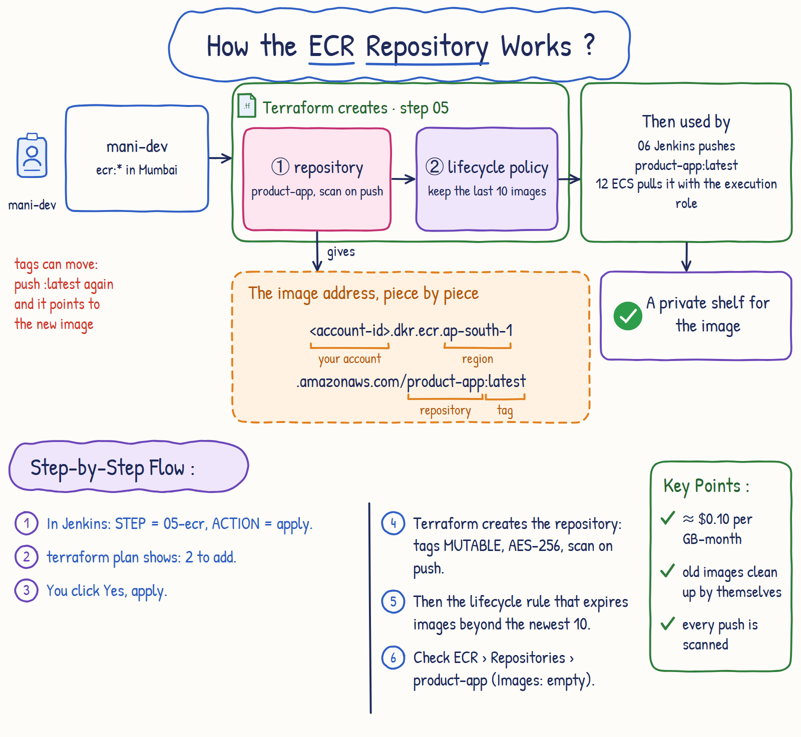
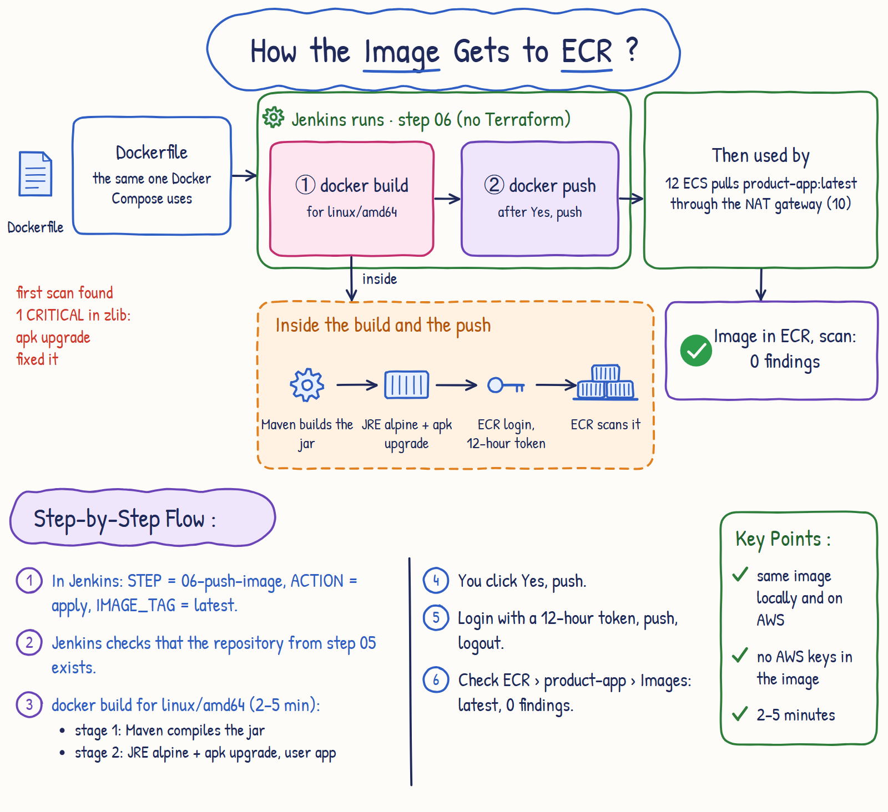
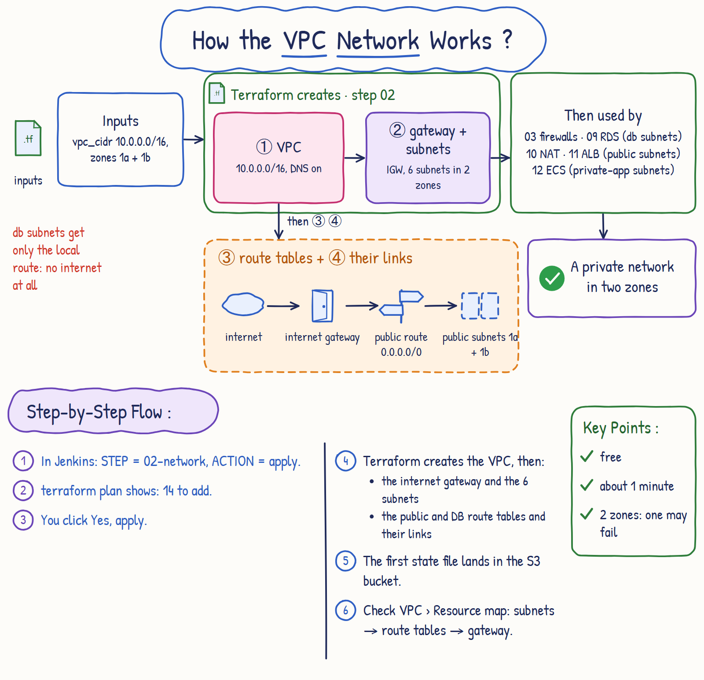

# 09 — Scaling and cost

## 1. What does the demo setup cost?

Approximate **monthly** prices for the default configuration (1 Fargate task 0.5 vCPU / 1 GB, 1 NAT
Gateway, 1 ALB, RDS `db.t4g.micro` single-AZ, 20 GB gp3), running 24 × 7 (730 h). List prices
in `ap-south-1` are a little higher than in `us-east-1`; always confirm with the
[AWS Pricing Calculator](https://calculator.aws).

What you are paying for: every part of this picture is billed differently. The four boxes inside the
VPC (load balancer, ECS task, RDS, NAT gateway) are the hourly charges; most of the rest is pennies.

| Service | What you pay for | Approx. / month | Share |
|---|---|---|---|
| **NAT Gateway** | ~$0.045–0.056 per hour **+** ~$0.045–0.056 per GB processed | **$33–41** + data | largest fixed cost |
| **Application Load Balancer** | ~$0.0225–0.025 per hour + LCU usage (tiny for a demo) | **$17–20** | |
| **ECS Fargate** (0.5 vCPU, 1 GB) | per-vCPU-hour + per-GB-hour, only while the task runs | **$18–22** | scales linearly with tasks |
| **RDS MySQL** `db.t4g.micro` single-AZ | instance hour + 20 GB gp3 storage + backup storage | **$14–17** | Multi-AZ ≈ ×2 |
| **Public IPv4 addresses** | $0.005 per hour per public IPv4 (NAT Elastic IP + one per ALB node = 3) | **≈ $11** | charged since Feb 2024 |
| Secrets Manager | $0.40 per secret + API calls | **$0.40** | |
| CloudWatch Logs | ~$0.50–0.57 per GB ingested + storage | **< $1** | |
| ECR | $0.10 per GB stored (image ≈ 0.3 GB) | **< $0.10** | |
| S3 (state) | a few KB | **≈ $0** | |
| Data transfer out | first 100 GB/month free (account-wide), then ~$0.09–0.11/GB | **≈ $0** for a demo | |
| **Total** | | **≈ $95–115 / month ≈ $3–4 / day** | |

Key takeaways:

- **Fixed hourly charges dominate**: NAT Gateway + ALB + their public IPs ≈ $65/month even with zero
  traffic. The application itself (Fargate + RDS) is only ≈ $35/month.
- **Nothing is free when idle.** Run `terraform destroy` when you stop learning for the day and
  `terraform apply` again later (≈ 15 minutes). Data in RDS is lost on destroy unless you set
  `db_skip_final_snapshot = false`.
- Set a **budget alert** (AWS Budgets → $20/month threshold) on day one.

### Cost explanations

**NAT Gateway** — Needed because the ECS tasks live in private subnets but must reach ECR (image pull),
CloudWatch Logs and Secrets Manager. Each task start pulls ~300 MB through it (data-processing charge).
Alternatives: (a) VPC interface endpoints for ECR (2), Logs and Secrets Manager + an S3 gateway endpoint
(free) — about $7–8 per interface endpoint per month, so roughly the same price but no internet path;
(b) for a pure demo, run tasks in public subnets with public IPs and no NAT (cheaper, less secure, not
what this project does).

**ALB** — Charged per hour plus Load Balancer Capacity Units (new connections, active connections,
processed bytes, rule evaluations). A demo stays at the minimum LCU.

**ECS Fargate** — Billed per second for the vCPU and memory you reserve, from image pull until task
stop. Doubling `desired_count` doubles the cost. Fargate Spot (not configured here) is up to 70 %
cheaper for workloads that tolerate interruption. ARM (Graviton) tasks are ~20 % cheaper: build the
image with `--platform linux/arm64` and set `cpu_architecture = "ARM64"` in `ecs.tf`.

**RDS** — Billed per instance hour, storage GB-month, backup storage above the free amount (equal to
the DB size) and I/O for some storage types (gp3 includes a baseline). Multi-AZ doubles the instance
and storage price. Stopping an RDS instance pauses instance charges for up to 7 days (then it restarts
automatically).

### The cheap and the free parts

Everything else in the bill is small or free. One board per service, with its cost in the Key Points box:

#### Secrets Manager · $0.40 per month

#### CloudWatch Logs · under $1 per month

#### ECR · under $0.10 per month

#### The image · storage only

#### S3 state bucket · about $0

#### VPC, subnets, route tables · free

#### Security groups · free

#### IAM roles · free

## 2. How to scale when usage increases

### Scale the application (ECS)

| Step | Change | Effect |
|---|---|---|
| More tasks, fixed | `desired_count = 2` in `terraform.tfvars` → `terraform apply` | ALB spreads requests across tasks in both AZs; survives one task/AZ failure |
| Bigger tasks | `container_cpu = 1024`, `container_memory = 2048` | More heap and CPU per task (valid Fargate combinations only) |
| Auto scaling | `enable_autoscaling = true`, `autoscaling_min_capacity = 2`, `autoscaling_max_capacity = 6`, `autoscaling_cpu_target = 60` | ECS adds tasks when average CPU > 60 % for a few minutes and removes them when it falls (see `autoscaling.tf`). With auto scaling on, `terraform plan` may show a `desired_count` difference after a scale event; add `lifecycle { ignore_changes = [desired_count] }` to `aws_ecs_service.app` so Terraform leaves that number to the scaler |
| Zero-downtime deploys | Nothing to change: already configured | Rolling deployment (200 % max, 100 % min healthy), circuit breaker with rollback, `deregistration_delay = 30`, graceful shutdown in Spring |

Rough capacity: one 0.5 vCPU task of this app handles a few hundred simple requests per second; the
database becomes the bottleneck long before the ALB does.

### Scale / harden the database (RDS)

| Step | Change | Effect |
|---|---|---|
| High availability | `db_multi_az = true` | Synchronous standby in the other AZ, automatic failover in ~1–2 min, same endpoint |
| Bigger instance | `db_instance_class = "db.t4g.small"` / `"db.m7g.large"` | More CPU/RAM/connections; RDS applies with a short restart (`apply_immediately = true`) |
| Storage | `db_allocated_storage = 100` (or add `max_allocated_storage` for autoscaling storage) | Can only grow |
| Backups | `db_backup_retention_days = 7`, `db_skip_final_snapshot = false`, `db_deletion_protection = true` | Point-in-time restore, safety against accidental destroy |
| Read scaling | Add an `aws_db_instance` with `replica_source_db = aws_db_instance.mysql.identifier` | Read replicas for read-heavy workloads; the app would need a second datasource |
| Connection pool | HikariCP `maximum-pool-size` (10 per task) × tasks must stay below the RDS `max_connections` (≈ 60–80 on t4g.micro) | Raise instance size before raising pool size |

### Scale the network

- Add a second NAT Gateway in AZ b (and a per-AZ private route table) so an AZ outage does not cut
  outbound access for tasks in the other AZ. Cost: one more ~$35/month.
- Enable `containerInsights` on the cluster for CPU/memory dashboards (CloudWatch metrics cost).

## 3. Cost-saving checklist for learning

1. `terraform destroy` when done for the day; `terraform apply` tomorrow.
2. Keep `log_retention_days` small (7).
3. One NAT Gateway (as configured). For a pure throw-away demo you could even temporarily put
   the tasks in public subnets, but the private layout is the production pattern worth learning.
4. Use `db.t4g.micro`/`db.t3.micro`, single-AZ, 1-day backups (as configured).
5. Create an AWS Budget with an email alert.

With Jenkins, point 1 is the `destroy-all` step: the same loop as every other step, but with
`terraform plan -destroy`, and you approve by typing `destroy` ([doc 11](11-jenkins-terraform-step-by-step.md), section 5).

