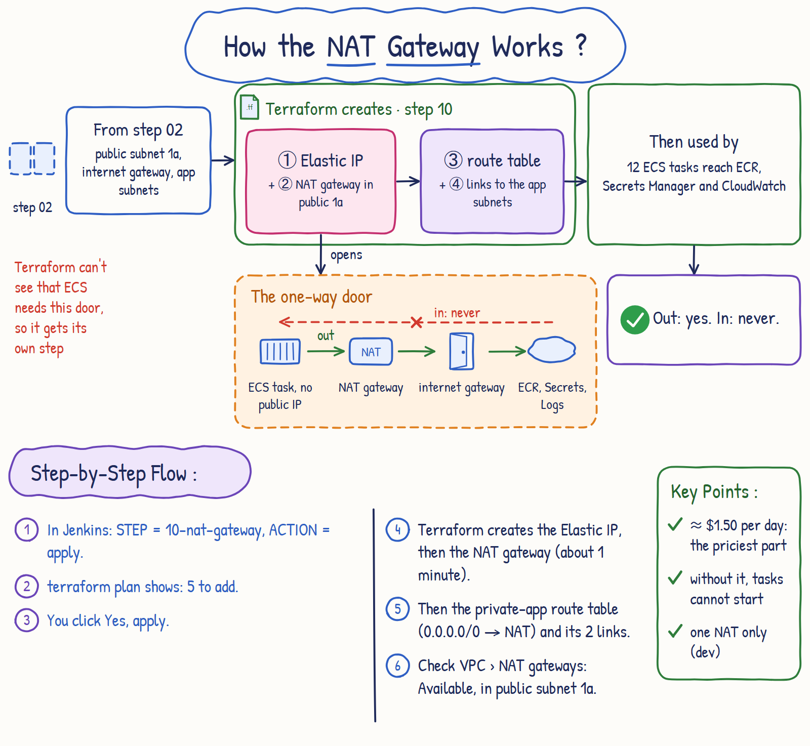
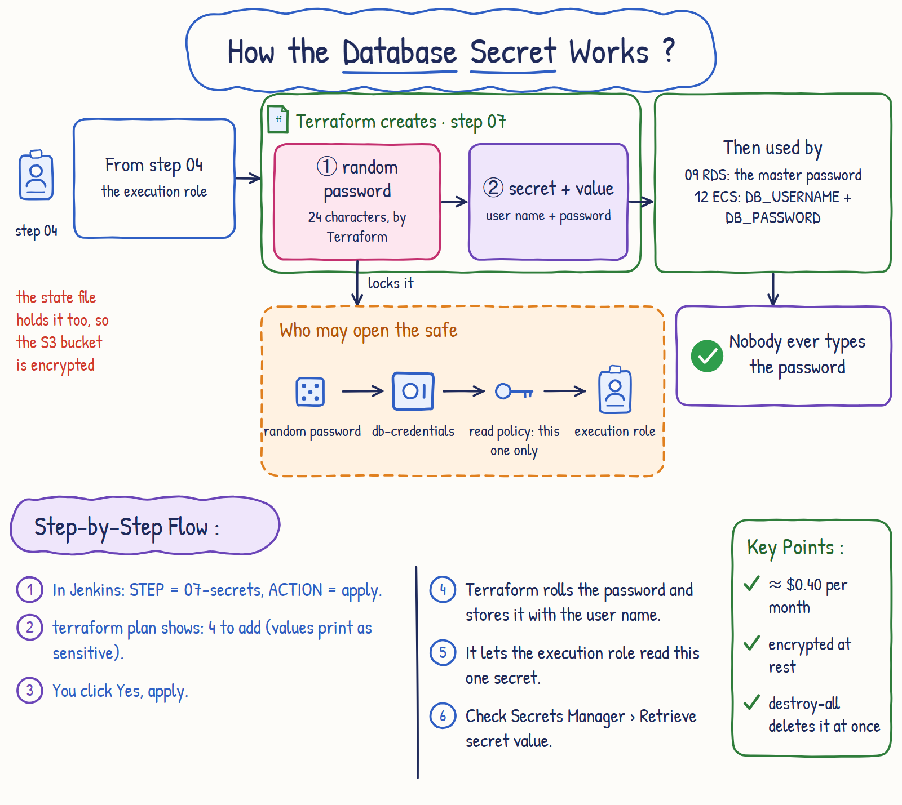
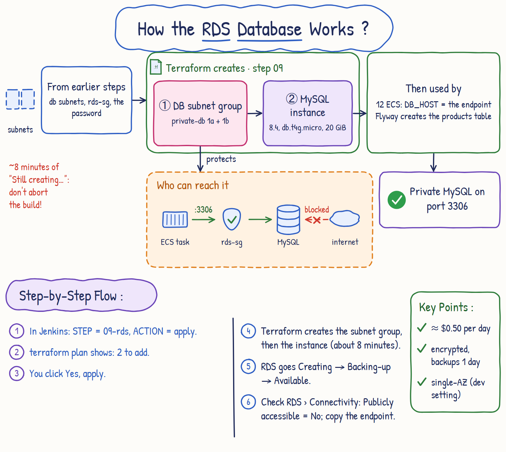
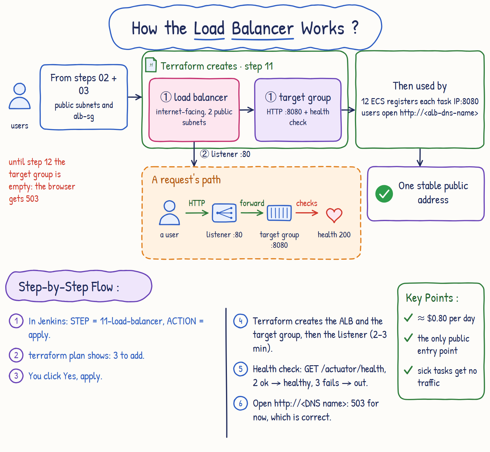

# 10 — Troubleshooting guide

Work from the outside in: **is the container running? → is it healthy? → what do the logs say? → can it reach the database?**

Use the finished picture as the map: start at the user and follow the arrows inwards.


## A. Local (Docker Compose)

### Quick diagnosis commands

```bash
cd product-app
docker compose ps                                   # state + (healthy)/(unhealthy)
docker compose logs --tail=200 app                  # application log
docker compose logs --tail=50 mysql                 # database log
docker inspect --format '{{json .State.Health}}' product-app | jq .   # last health check outputs (jq optional)
docker compose exec app wget -qO- http://localhost:8080/actuator/health   # health from inside the container
docker compose exec mysql mysqladmin ping -h 127.0.0.1 -u root -proot_pass
docker compose config                               # shows the fully resolved compose file (env substituted)
```

### Problems and fixes

| Symptom | Likely cause | Fix |
|---|---|---|
| `docker compose up` exits immediately with `Set MYSQL_PASSWORD in the .env file` | No `.env` | `cp .env.example .env` |
| Port already allocated (3307 / 8080) | Another process uses it | Change `MYSQL_HOST_PORT` / `APP_HOST_PORT` in `.env`, then `docker compose up -d` |
| `product-mysql` stays `starting` then `unhealthy` | First init slow, low RAM, or corrupted volume | Look at `docker compose logs mysql`; `docker compose down -v` to start fresh |
| `product-app` restarts repeatedly | Exception during start | `docker compose logs app` — read the **first** `ERROR`/`Caused by` |
| `Could not resolve placeholder 'DB_USERNAME'` | Env var missing (running jar outside Compose) | Export `DB_USERNAME`, `DB_PASSWORD` or use Compose |
| `Access denied for user 'product_user'@'%'` | `.env` password changed after the volume was initialised | `docker compose down -v && docker compose up -d` |
| `Communications link failure` / `Connection refused` | `DB_HOST` wrong or MySQL not ready | `DB_HOST` must be `mysql`; keep `condition: service_healthy` |
| `Flyway ... checksum mismatch` | A migration file was edited after being applied | Restore the file; add a new `V2__` file. Dev only: `down -v` |
| `Schema-validation: missing table [products]` | Flyway did not run | `spring.flyway.enabled`, file under `db/migration`, file name `V1__...sql` |
| Swagger UI 404 | Wrong URL | Use `/swagger-ui/index.html` (not `/swagger-ui`) |
| Health is `DOWN` with `db: DOWN` | DB connection broken after start | Restart MySQL; check pool errors in the log |
| Changes in code not visible | Old image still running | `docker compose up -d --build app` |
| `docker compose build` very slow | First build downloads all Maven dependencies | Normal once; later builds reuse the BuildKit cache |
| Windows: `curl` prints odd output or errors | PowerShell alias | Use `curl.exe` or `Invoke-RestMethod` |

### Reset everything locally

```bash
docker compose down -v --rmi local      # containers, volume, image
docker compose up -d --build --wait
```

## B. Build and tests

| Symptom | Fix |
|---|---|
| `mvn test` → `Could not find a valid Docker environment` | Start Docker Desktop (Testcontainers needs it), or run only unit tests: `mvn test -Dtest='ProductServiceTest,ProductControllerTest'` |
| `mvn test` hangs pulling `mysql:8.0.46` | First pull of the image; wait, or `docker pull mysql:8.0.46` beforehand |
| Compilation error about `javax.*` | This project uses Jakarta EE (`jakarta.persistence`, `jakarta.validation`) |
| `Fatal error compiling: error: release version 25 not supported` | Maven runs on an older JDK. `mvn -version` must show `Java version: 25...`. Use a VS Code terminal in this folder (it gets JDK 25 from `.vscode/settings.json`), or set it for the current window: PowerShell `$env:JAVA_HOME = "C:\Program Files\Java\latest\jdk-25"`, Git Bash `export JAVA_HOME="/c/Program Files/Java/latest/jdk-25"` |
| `mvn compile` says `BUILD SUCCESS` on the wrong JDK, or old classes are used after changing `java.version` | Maven reused the classes already in `target/` and compiled nothing. Add `clean`, for example `mvn clean verify` |

## C. AWS (ECS Fargate / RDS / ALB)

### Quick diagnosis commands

```bash
cd terraform
CLUSTER=$(terraform output -raw ecs_cluster_name); SERVICE=$(terraform output -raw ecs_service_name)

# 1. Is the service running the desired number of tasks?
aws ecs describe-services --cluster $CLUSTER --services $SERVICE \
  --query 'services[0].{desired:desiredCount,running:runningCount,pending:pendingCount,events:events[0:5].message}'

# 2. Why did the last task stop?
aws ecs list-tasks --cluster $CLUSTER --service-name $SERVICE --desired-status STOPPED
aws ecs describe-tasks --cluster $CLUSTER --tasks <task-arn> \
  --query 'tasks[0].{stopCode:stopCode,reason:stoppedReason,containers:containers[].{name:name,reason:reason,exit:exitCode}}'

# 3. Application logs
aws logs tail /ecs/product-app-dev --since 30m
aws logs tail /ecs/product-app-dev --follow

# 4. Load balancer target health
TG=$(aws elbv2 describe-target-groups --names product-app-dev-tg --query 'TargetGroups[0].TargetGroupArn' --output text)
aws elbv2 describe-target-health --target-group-arn $TG

# 5. Database status
aws rds describe-db-instances --db-instance-identifier product-app-dev-mysql \
  --query 'DBInstances[0].{status:DBInstanceStatus,endpoint:Endpoint.Address,engine:EngineVersion}'

# 6. Secret exists and has both keys (prints the JSON: do this only in a private terminal)
aws secretsmanager get-secret-value --secret-id product-app-dev/db-credentials --query SecretString --output text
```

### Which part failed? Follow the start-up

When a task starts, ECS goes through the stages in the orange strip "When the task starts" on the step 12
board below: pull the image through the NAT, read the password, Flyway connects to RDS, the load balancer
marks the task healthy. The error message tells you which stage failed; the board for that part shows what
it needs and which step created it ([doc 11](11-jenkins-terraform-step-by-step.md) has the console
checklist for every step).

#### 12 · ECS: the start-up sequence (start here)


#### 06 · The image: `CannotPullContainerError ... not found`, `exec format error`


#### 05 · ECR: the tag in `image_tag` must exist here


#### 10 · NAT gateway: `CannotPullContainerError ... i/o timeout`



#### 04 · IAM roles: `ResourceInitializationError`, empty logs


#### 07 · Secrets Manager: `unable to pull secrets`, `Access denied for user`



#### 08 · CloudWatch Logs: no logs at all


#### 09 · RDS: `Communications link failure`, `InvalidParameterCombination`



#### 03 · Security groups: targets `unhealthy`, `connect timed out`


#### 11 · Load balancer: `503`, `502`, `504`, targets `unhealthy`



#### 02 · VPC: subnet / Availability Zone errors, `destroy` stuck on an ENI


### Problems and fixes

| Symptom | Likely cause | Fix |
|---|---|---|
| `stoppedReason: CannotPullContainerError ... not found` | Tag in `image_tag` was never pushed | `./scripts/build-and-push.sh <tag>` then re-apply / redeploy |
| `CannotPullContainerError ... i/o timeout` | Tasks cannot reach ECR: NAT Gateway missing or private route table wrong | `terraform plan` should be clean; check `aws_route_table.private_app` has the NAT route |
| `ResourceInitializationError: unable to pull secrets or registry auth` | Execution role lacks permission, or secret ARN wrong | Compare the ARN in the task definition with `terraform output db_secret_arn`; re-apply `iam.tf` |
| Task exits with code 1, log shows `Access denied for user` | Secret and RDS password differ (secret edited by hand) | Never edit the secret manually; `terraform apply` restores it (`random_password` is in state) |
| Log shows `Communications link failure` / `connect timed out` to RDS | RDS SG does not allow ECS SG, or RDS still `creating`/`modifying` | Wait until `available`; verify `rds_from_ecs` rule |
| Task healthy in ECS but ALB targets `unhealthy` | ECS SG does not allow 8080 from the ALB SG, or health path wrong | Check `security_groups.tf`, target group health path `/actuator/health`, matcher 200 |
| ALB returns `503 Service Unavailable` | No healthy targets yet (first 2–3 min after apply) or deployment rolling | Wait; check target health |
| ALB returns `502 Bad Gateway` | Container crashed while handling a request / restarted | Logs; check memory (`container_memory`) — OOM kills show exit code 137 |
| ALB returns `504 Gateway Time-out` | Request took > 60 s (ALB idle timeout) | Usually a DB problem; see logs |
| `exec /usr/bin/java: exec format error` | Image architecture mismatch (ARM image on X86_64 task) | Rebuild with `--platform linux/amd64` or set `cpu_architecture = "ARM64"` |
| Service keeps deploying and rolling back | Circuit breaker: new tasks never healthy | Read stopped task reason (command 2 above); fix; redeploy |
| Health check kills tasks during start | JVM + Flyway slower than `startPeriod` / grace period | Increase `startPeriod` (ecs.tf) and `health_check_grace_period_seconds` (ecs_service.tf) |
| Logs empty in CloudWatch | Log group name/region mismatch, or execution role missing logs permissions | `cloudwatch.tf` name must equal `awslogs-group`; managed policy covers `logs:*Put*` |
| After `docker push` with tag `latest`, nothing changes | ECS does not re-pull the same tag by itself | `./scripts/redeploy.sh` (`--force-new-deployment`) or use a new tag |
| Flyway fails on RDS: `checksum mismatch` | Migration edited after it ran on RDS | Same rule as locally; add a new migration. Last resort: `flyway repair` from a bastion/one-off task |
| `terraform destroy` fails: secret scheduled for deletion | Recovery window > 0 | `aws secretsmanager delete-secret --secret-id ... --force-delete-without-recovery`, keep `secret_recovery_window_days = 0` in dev |
| `terraform destroy` fails: ENI / subnet in use | ECS tasks or NAT still releasing | Re-run `terraform destroy` after a minute |

### Reading a stopped task

The most useful single command when something is wrong on AWS:

```bash
aws ecs describe-tasks --cluster $CLUSTER \
  --tasks $(aws ecs list-tasks --cluster $CLUSTER --service-name $SERVICE --desired-status STOPPED --query 'taskArns[0]' --output text) \
  --query 'tasks[0].[stopCode,stoppedReason,containers[0].reason,containers[0].exitCode]' --output table
```

| `stopCode` / `reason` | Meaning |
|---|---|
| `TaskFailedToStart` + `CannotPullContainerError` | Image / network problem before the container ran |
| `TaskFailedToStart` + `ResourceInitializationError` | Secrets or logs could not be set up (IAM) |
| `EssentialContainerExited`, exit code 1 | Spring Boot threw during startup → read CloudWatch logs |
| `EssentialContainerExited`, exit code 137 | Out of memory → raise `container_memory` |
| `ServiceSchedulerInitiated` + `(ELB) health checks failed` | App ran but `/actuator/health` was not 200 in time |

## D. Terraform

| Error | Fix |
|---|---|
| `No valid credential sources found` | `export AWS_PROFILE=...` in **this** terminal; `aws sts get-caller-identity` |
| `AccessDenied` on any API | Missing IAM permission (see doc 08, step 0) |
| `Backend configuration changed` | `terraform init -reconfigure -backend-config=backend.hcl` |
| `Error acquiring the state lock` | Another run in progress; if stale: `terraform force-unlock <LOCK_ID>` |
| `Error: creating RDS DB Instance ... InvalidParameterCombination` | Instance class not available for MySQL 8.4 in the region → set `db_instance_class = "db.t3.micro"` (or another supported class) |
| `Error: creating ELBv2 ... A load balancer cannot be attached to multiple subnets in the same Availability Zone` | `availability_zones` has duplicates or the wrong region → set two different AZs of `aws_region` |
| Plan wants to recreate the task definition on every run | Normal when the image tag or env changes; otherwise a `jsonencode` type difference (numbers vs strings) → the configuration uses `tostring()` where needed |
| `terraform apply` hangs on RDS | RDS creation takes 5–10 min → wait; watch `aws rds describe-db-instances` |

### 01 · State bucket: `Error acquiring the state lock`, `Backend configuration changed`


### Jenkins: the build stops after the plan, or ends `ABORTED`

With `ACTION = plan` the build stops after the plan on purpose; with `apply`, nobody clicking within 60 minutes
ends it as `ABORTED` and nothing changes ([doc 11](11-jenkins-terraform-step-by-step.md), section 6).


