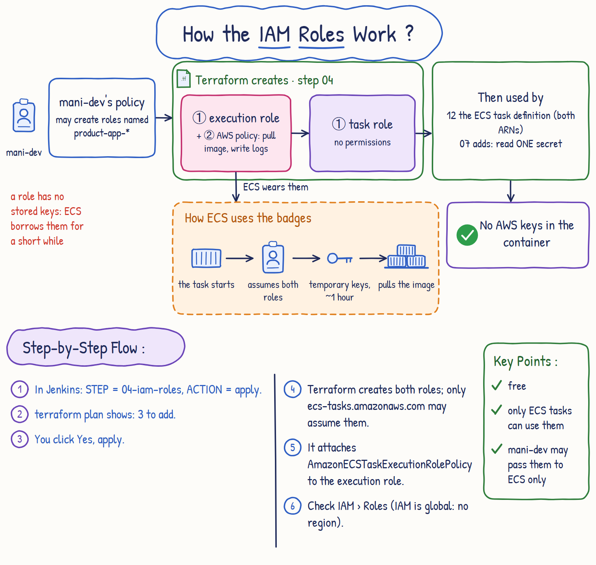

# 11 — Create the AWS resources one step at a time with Jenkins and Terraform

This guide builds the AWS side of product-app in **13 small steps**. Each step is one Jenkins build
that creates one group of related resources. After each step you open the AWS console, look at what
was created, and only then start the next step.

It uses exactly the same Terraform code as [07-terraform.md](07-terraform.md) and
[08-aws-deployment-steps.md](08-aws-deployment-steps.md). The difference is *how* it is run: Jenkins
runs Terraform for you, one group of resources at a time, instead of one big `terraform apply`.

> **Region.** Everything is created in **Asia Pacific (Mumbai) `ap-south-1`**. In the AWS console,
> pick Mumbai in the region menu at the top right, or you will not see the resources. Your AWS CLI's
> default region (`ap-south-2`, Hyderabad) does not matter here, because the pipeline sets the region
> itself. IAM roles are global, so the IAM console has no region.

## 1. How the pipeline works


The same loop in text form:

```
 You (browser)                Jenkins container (localhost:8090)                     AWS (ap-south-1)
 ─────────────                ──────────────────────────────────                     ────────────────
 Build with Parameters ──►  1 Get project files   copy D:\Drive E\nibe\aws-dev
   STEP   = 02-network       2 Who am I in AWS     aws sts get-caller-identity  ───►  IAM user mani-dev
   ACTION = apply            3 Terraform plan      docker: hashicorp/terraform  ───►  reads state from S3
                             4 Approve  ◄── you click "Yes, apply"
                             5 Terraform apply     creates ONLY the step's resources ─►  VPC, subnets, ...
                                                   saves the new state in S3
 AWS console ◄── you check the new resources, then run the next STEP
```

Key ideas:

| Idea | What it means here |
|---|---|
| **One build = one step** | The `STEP` parameter picks a group of resources. Jenkins passes them to Terraform as `-target=...`. |
| **plan, then apply** | `ACTION = plan` only prints what would happen. `ACTION = apply` prints the same plan, then **pauses** until you click **Yes, apply**. |
| **Tools in containers** | Jenkins only has the Docker CLI. Terraform runs in `hashicorp/terraform:1.17.0` and the AWS CLI in `amazon/aws-cli:2.36.24`. |
| **AWS keys in Jenkins** | The keys of IAM user `mani-dev` are a Jenkins credential `aws-mani-dev`. Jenkins hides them as `****` in every log. |
| **State** | Terraform remembers what it created in a *state file*. It lives in the S3 bucket from step 01, so every build sees the result of the previous builds. |
| **Order matters** | Each step needs things from earlier steps. Example: subnets (step 02) must exist before the database (step 09) can be placed in them. |

Files involved:

| File | Role |
|---|---|
| [jenkins/Jenkinsfile](../jenkins/Jenkinsfile) | The pipeline: parameters, stages, and which resources each step targets (`STEP_TARGETS`) |
| [scripts/jenkins-setup.sh](../scripts/jenkins-setup.sh) | One-time setup: stores the AWS keys in Jenkins and creates the job |
| `terraform/*.tf` | The infrastructure code (unchanged) |
| `terraform/bootstrap/main.tf` | The state bucket (step 01) |
| [scripts/smoke-test.sh](../scripts/smoke-test.sh) | API checks, used by step 13 through the load balancer |

## 2. One-time setup

### 2.1 Give `mani-dev` the permissions Terraform needs

Today `mani-dev` can only use ECR. Ask your AWS administrator to attach
[terraform/deployer-iam-policy.json](../terraform/deployer-iam-policy.json) to the user, as described in
[08-aws-deployment-steps.md](08-aws-deployment-steps.md), step 0. Without it, every step after the
preflight fails with `AccessDenied` or `UnauthorizedOperation`.

### 2.2 Store the AWS keys in Jenkins and create the job

In Git Bash, from the project root:

```bash
./scripts/jenkins-setup.sh
```

It asks for your Jenkins user name and password, then:

1. reads the keys of your AWS CLI `default` profile (`mani-dev`) and checks them with AWS,
2. stores them in Jenkins as the credential **aws-mani-dev**,
3. creates the job **product-app-aws-terraform** from `jenkins/Jenkinsfile`.

Expected output:

```
Jenkins: logged in to http://localhost:8090 as <your user>
AWS: profile 'default' is arn:aws:iam::<account-id>:user/mani-dev
Jenkins: credential 'aws-mani-dev': added
Jenkins: job 'product-app-aws-terraform' created -> http://localhost:8090/job/product-app-aws-terraform/
```

After you change the Jenkinsfile later, update the job with `./scripts/jenkins-setup.sh --job-only`.

<details>
<summary>Doing the same by hand in the Jenkins UI</summary>

1. **Credential:** Manage Jenkins → Credentials → System → Global credentials → **Add Credentials**.
   Kind *Username with password*. Username = the access key ID, Password = the secret access key,
   ID = `aws-mani-dev`. Tick *Treat username as secret*. You find both keys in
   `C:\Users\<you>\.aws\credentials` under `[default]`.
2. **Job:** New Item → name `product-app-aws-terraform` → *Pipeline* → OK. In *Pipeline*, choose
   *Pipeline script* and paste the whole content of `jenkins/Jenkinsfile`. Keep *Use Groovy Sandbox* ticked. Save.

</details>

### 2.3 First build

A new pipeline job does not know its parameters until it has run once. Click **Build Now** once. From
then on the job shows **Build with Parameters**.

Jenkins only reads the `parameters { ... }` block of the Jenkinsfile *while* that first build runs, so
the first build itself starts **without** parameters: `params.STEP` is empty and `$PROJECT_DIR` does not
exist in `sh` steps. The Jenkinsfile handles this: its first stage copies every parameter into a
`RUN_*` variable with the default value as fallback (`RUN_STEP = 00-preflight`, `RUN_ACTION = plan`, ...),
and all later stages read only those copies. The first build therefore runs the read-only preflight
and prints `First build of this job: no parameters yet ...`.

### 2.4 SonarQube token for the code-quality stages

`STEP = code-quality` and step 06 send the code to **your** SonarQube (the `sonarqube/` folder, doc 13).
Jenkins needs its own analysis token for that:

1. Start SonarQube if it is not running: `cd sonarqube; docker compose up -d --wait`.
2. In SonarQube (<http://localhost:9000>): avatar → **My Account** → **Security** → *Generate Tokens*.
   Name `jenkins`, type **Global Analysis Token**, expiry **90 days**. **Generate**, copy it.
   (Your own token in `product-app/.env` would also work, but a separate one can be revoked on its own.)
3. In Git Bash, from the project root:

   ```bash
   ./scripts/jenkins-setup.sh --sonar-token
   ```

   It asks for your Jenkins login and the token (hidden input; press Enter to reuse `SONAR_TOKEN`
   from `product-app/.env`), checks the token with SonarQube, stores it in Jenkins and updates the job.

Expected output:

```text
Jenkins: logged in to http://localhost:8090 as <your user>
SonarQube: token accepted by http://localhost:9000
Jenkins: credential 'sonar-token': added
Jenkins: job 'product-app-aws-terraform' updated -> http://localhost:8090/job/product-app-aws-terraform/
```

By hand instead: Manage Jenkins → Credentials → System → Global credentials → **Add Credentials**,
kind *Secret text*, Secret = the token, ID = `sonar-token`.

> **Only one SonarQube on port 9000.** The BridgeEnrollment CI stack (`ci/compose.yaml`) has its own
> `sonarqube` container on port 9000, with the same container name as the one in `sonarqube/`. Start only
> its Jenkins (`docker compose up -d jenkins` in `BridgeEnrollment/ci`) while the product-app SonarQube runs.

## 3. How to run every step

1. Open http://localhost:8090/job/product-app-aws-terraform/ → **Build with Parameters**.
2. Choose the `STEP`, keep `ACTION = plan`, click **Build**. Open the build → **Console Output**.
   Read the plan: every line with `+` is a resource that would be created. The last line says
   `Plan: N to add, 0 to change, 0 to destroy.`
3. Run the same `STEP` again with `ACTION = apply`. The build **pauses** at **Approve** and prints an
   `ACTION NEEDED` banner. Read the plan in the console once more, then approve it in one of these places:
   - the link in the banner, `http://localhost:8090/job/product-app-aws-terraform/<build number>/input/`,
     then the **Yes, apply** button;
   - the small **Yes, apply** link on the very last line of the Console Output;
   - the build page: the paused **Approve** stage shows **Yes, apply** / **Abort**.

   Stay with the build until you have clicked. Nobody approves automatically: after 60 minutes
   without a click the build ends as **ABORTED** and nothing is changed in AWS.
4. When the build is green, check the resources in the AWS console with the checklist of that step below.
5. Continue with the next step only when the checklist is complete.

The end of every apply prints `terraform state list`, the list of everything Terraform manages so far.
It grows with every step.

| Step | Creates | Approx. cost while it exists | Time |
|---|---|---|---|
| 00-preflight | nothing (permission check) | – | 1 min |
| 01-state-bucket | S3 bucket for the Terraform state | ≈ $0 | 1 min |
| 02-network | VPC, 6 subnets, internet gateway, 2 route tables | free | 1 min |
| 03-security-groups | 3 security groups and their rules | free | 1 min |
| 04-iam-roles | ECS task execution role, ECS task role | free | 1 min |
| 05-ecr | ECR repository + lifecycle policy | ≈ $0.10 per GB stored | 1 min |
| 06-push-image | the product-app image in ECR | (storage above) | 3–5 min |
| 07-secrets | DB password in Secrets Manager + read permission for ECS | $0.40 / month | 1 min |
| 08-cloudwatch-logs | log group `/ecs/product-app-dev` | ≈ $0 until logs arrive | 1 min |
| 09-rds | MySQL database `db.t4g.micro` | ≈ $0.50 / day | 8–12 min |
| 10-nat-gateway | NAT gateway + Elastic IP + private route table | ≈ $1.50 / day | 2–3 min |
| 11-load-balancer | ALB, target group, HTTP listener | ≈ $0.80 / day | 3–4 min |
| 12-ecs | ECS cluster, task definition, service: the app starts | ≈ $0.70 / day | 3–5 min |
| 13-verify | nothing (full check + API test) | – | 2 min |

From step 09 on, AWS charges by the hour. Do steps 09 to 13 on the same day, and run `destroy-all`
(section 5) when you are finished. See [09-scaling-and-cost.md](09-scaling-and-cost.md) for details.

## 4. The steps

Each step below starts with its hand-drawn board from the [sketchbook](12-aws-sketchbook.html). This is where the twelve steps lead: every part is labelled with the step that creates it.


### Step 00 — Preflight (read-only)

**What and why.** Checks *who* Jenkins is in AWS and whether that user may use each service Terraform
needs. It changes nothing. It turns a confusing error in step 05 into a clear list now.

**Expected output** once the policy is attached:

```
OK      EC2/VPC: read
OK      EC2/VPC: create (dry run)
...
All permissions needed by the next steps are present.
```

A `DENIED` line names the missing service. The build fails until the policy from section 2.1 is attached.

### Step 01 — Terraform state bucket (S3)


**What.** An S3 bucket `product-app-tfstate-<account-id>` with versioning, encryption and all public
access blocked. Config: `terraform/bootstrap/main.tf`.

**Why.** Terraform must remember what it created, so the next build only adds what is new. That memory
is the *state file*. Keeping it in S3, instead of on one PC, means Jenkins and you always see the same
state, every old version is kept, and the S3 lockfile stops two runs from changing it at once.

**How.** The bucket cannot store its own state before it exists. So this one small state file stays in
Jenkins' home folder: `/var/jenkins_home/terraform-state/product-app/bootstrap.tfstate`.

**Console checklist** (S3 → Buckets):

- [ ] `product-app-tfstate-<account-id>` exists in *Asia Pacific (Mumbai)*.
- [ ] *Properties* → **Bucket Versioning: Enabled**, **Default encryption: SSE-S3**.
- [ ] *Permissions* → **Block all public access: On**.
- [ ] *Objects* is empty. The state file of the main configuration appears there after step 02.

**Common errors.** `BucketAlreadyExists`: the name is taken worldwide; it contains your account ID, so
this only happens if the bucket exists in another region of your account.

### Step 02 — Network (VPC)


**What.** VPC `product-app-dev-vpc` (`10.0.0.0/16`), six subnets in two Availability Zones, an internet
gateway, a public route table and a database route table. Config: `terraform/vpc.tf`.

| Subnet | CIDR | Used by | Internet |
|---|---|---|---|
| `product-app-dev-public-ap-south-1a` / `-1b` | 10.0.0.0/24, 10.0.1.0/24 | load balancer, NAT gateway | in and out, through the internet gateway |
| `product-app-dev-private-app-ap-south-1a` / `-1b` | 10.0.10.0/24, 10.0.11.0/24 | ECS tasks | out only, through the NAT gateway (step 10) |
| `product-app-dev-private-db-ap-south-1a` / `-1b` | 10.0.20.0/24, 10.0.21.0/24 | RDS | none |

**Why.** A private network just for this application. Two AZs because the load balancer and RDS
require subnets in at least two AZs, and so one data center failure does not stop the app.

**Console checklist** (VPC console):

- [ ] *Your VPCs* → `product-app-dev-vpc`, CIDR `10.0.0.0/16`. Open its **Resource map** tab: it draws
      the subnets, route tables and gateway and how they connect.
- [ ] *Subnets*: six `product-app-dev-...` subnets, each pair in `ap-south-1a` and `ap-south-1b`.
- [ ] *Internet gateways*: `product-app-dev-igw`, state **Attached** to the VPC.
- [ ] *Route tables* → `product-app-dev-public-rt` → *Routes*: `0.0.0.0/0 → igw-...`.
      *Subnet associations*: the two public subnets.
- [ ] `product-app-dev-private-db-rt` has only the `local` route: the database has no internet path.
- [ ] S3 bucket from step 01 → *Objects*: `product-app/dev/terraform.tfstate` now exists.

The private-app subnets have no route table of their own yet. Step 10 adds it with the NAT gateway.

### Step 03 — Security groups (firewall rules)


**What.** Three security groups that form a chain. Config: `terraform/security_groups.tf`.

```
 internet ──80──► [ product-app-dev-alb-sg ] ──8080──► [ product-app-dev-ecs-sg ] ──3306──► [ product-app-dev-rds-sg ]
```

**Why.** Each layer accepts traffic **only from the layer in front of it**. The rules name the other
security group as the source, not an IP address, so they keep working when tasks get new IPs.

**Console checklist** (EC2 → Network & Security → Security Groups, filter `product-app`):

- [ ] `product-app-dev-alb-sg`: inbound TCP 80 from `0.0.0.0/0`. Outbound TCP 8080 to `product-app-dev-ecs-sg`.
- [ ] `product-app-dev-ecs-sg`: inbound TCP 8080 from `product-app-dev-alb-sg`. Outbound all traffic.
- [ ] `product-app-dev-rds-sg`: inbound TCP 3306 from `product-app-dev-ecs-sg`. No other inbound rule.
- [ ] All three belong to `product-app-dev-vpc`.

Port 443 appears only when HTTPS is configured (see 08, *Optional: HTTPS*).

### Step 04 — IAM roles for ECS



**What.** Two roles. Config: `terraform/iam.tf`.

| Role | Used by | Permissions |
|---|---|---|
| `product-app-dev-ecs-task-execution-role` | the ECS agent, **before** the container starts | pull the image from ECR, write logs (AWS managed policy `AmazonECSTaskExecutionRolePolicy`). Step 07 adds reading the DB secret. |
| `product-app-dev-ecs-task-role` | the Java application, **while** it runs | none: the app calls no AWS API |

**Why.** Least privilege: ECS gets exactly the rights it needs, and no AWS keys are ever put into
the container.

**Console checklist** (IAM → Roles, search `product-app`):

- [ ] Both roles exist. *Trust relationships* of each: principal **ecs-tasks.amazonaws.com**.
      This says "only ECS tasks may use this role".
- [ ] Execution role → *Permissions*: `AmazonECSTaskExecutionRolePolicy`. Open it to see the ECR and logs actions.
- [ ] Task role → *Permissions*: empty.

### Step 05 — ECR repository


**What.** Private Docker image repository `product-app`, scan on push, keeps the last 10 images.
Config: `terraform/ecr.tf`.

**Why.** ECS must pull the image from a registry it can reach with IAM permissions. ECR is that
registry, inside your account.

**Console checklist** (ECR → Private registry → Repositories):

- [ ] `product-app` exists, *Tag immutability: Mutable*, *Scan on push: Enabled*.
- [ ] *Lifecycle Policy* (left menu inside the repository): rule "Keep the last 10 images".
- [ ] *Images*: empty. Copy the **URI**: `<account-id>.dkr.ecr.ap-south-1.amazonaws.com/product-app`.

### Step 06 — Build the image and push it to ECR


**What.** Jenkins builds the image from `product-app/Dockerfile` (the same one Docker Compose uses) for
`linux/amd64` and pushes it as `product-app:latest`. No Terraform in this step.

**Why.** Step 12 starts the container from this image. Building it once and running the identical
image locally and on AWS is a core rule of the project.

**Quality first.** Before it builds anything, this step runs the two code-quality stages (tests + JaCoCo
coverage, SonarQube + Quality Gate; see [Code quality](#code-quality-step-code-quality) below). If a test
fails, coverage drops below 80 % or the Quality Gate is red, the build stops there and nothing is pushed.
It needs the `sonar-token` credential (section 2.4) and a running SonarQube.

`ACTION = plan` only builds the image. `ACTION = apply` builds it, waits for **Yes, push**, logs in to
ECR with a 12-hour token, pushes, and logs out again.

**Console checklist** (ECR → `product-app` → Images):

- [ ] Image tag `latest`, pushed a few minutes ago, size ≈ 100–200 MB (compressed).
- [ ] Open the image → *Vulnerabilities*: the result of the automatic scan.

### Step 07 — Database credentials in Secrets Manager


**What.** Terraform generates a random 24-character password and stores
`{"username":"product_user","password":"..."}` as the secret `product-app-dev/db-credentials`. It also
adds the inline policy `read-db-credentials-secret` to the execution role. Config: `terraform/secrets.tf`, `terraform/iam.tf`.

**Why.** Nobody types or sees the password, and it is not in any file in the project. RDS (step 09)
gets it from Terraform. ECS (step 12) reads it from Secrets Manager when a task starts.

**Console checklist:**

- [ ] Secrets Manager → `product-app-dev/db-credentials` → **Retrieve secret value** shows the two keys.
- [ ] IAM → `product-app-dev-ecs-task-execution-role` → *Permissions*: new inline policy
      `read-db-credentials-secret`. Its JSON allows `secretsmanager:GetSecretValue` on **this one secret ARN only**.

### Step 08 — CloudWatch log group


**What.** Log group `/ecs/product-app-dev`, logs kept 7 days. Config: `terraform/cloudwatch.tf`.

**Why.** Containers on Fargate have no disk you can log in to. Everything the app prints goes here.

**Console checklist** (CloudWatch → Logs → Log groups):

- [ ] `/ecs/product-app-dev`, *Retention: 1 week*, no log streams yet. Step 12 fills it.

### Step 09 — RDS MySQL database


**What.** MySQL 8.4 instance `product-app-dev-mysql` (`db.t4g.micro`, 20 GB gp3, encrypted, single-AZ,
not public) in the two private DB subnets. Config: `terraform/rds.tf`. Takes 8–12 minutes.

**Why.** The managed version of the MySQL container you used locally: AWS handles backups, patches and
the server. Flyway creates the tables when the app starts in step 12, exactly like locally.

**How it connects.** Subnet group = the private-db subnets (step 02). Security group =
`product-app-dev-rds-sg` (step 03). Password = the one in the secret (step 07).

**Console checklist** (RDS → Databases → `product-app-dev-mysql`):

- [ ] *Status: Available*, *Engine: MySQL Community 8.4.x*, *Class: db.t4g.micro*.
- [ ] *Connectivity & security*: VPC `product-app-dev-vpc`, subnet group `product-app-dev-db-subnet-group`,
      **Publicly accessible: No**, security group `product-app-dev-rds-sg`. Note the **Endpoint**.
- [ ] *Configuration*: storage *gp3*, 20 GiB, **Encryption: Enabled**, master username `product_user`.

**Common errors.** `InvalidParameterCombination` about the instance class or version: that combination
is not offered in the region. Change `db_instance_class` or `db_engine_version` in `terraform.tfvars`.

### Step 10 — NAT gateway


**What.** Elastic IP `product-app-dev-nat-eip`, NAT gateway `product-app-dev-nat` in the first public
subnet, and route table `product-app-dev-private-app-rt` (`0.0.0.0/0 → NAT`) for the private-app subnets.
Config: `terraform/vpc.tf`.

**Why.** ECS tasks run in private subnets and have no public IP. They still have to reach ECR (image),
Secrets Manager (password) and CloudWatch (logs). The NAT gateway lets them make those outbound
connections, while nobody on the internet can connect to them.

This is the most expensive fixed resource. It comes this late so that it exists only while you need it.

Terraform does not know that ECS needs the NAT gateway: nothing in `ecs_service.tf` refers to it. Without
this step, step 12 would create the service, but tasks would fail with `CannotPullContainerError`.

**Console checklist** (VPC console):

- [ ] *NAT gateways*: `product-app-dev-nat`, *State: Available*, subnet `product-app-dev-public-ap-south-1a`,
      with the Elastic IP `product-app-dev-nat-eip`.
- [ ] *Route tables* → `product-app-dev-private-app-rt`: route `0.0.0.0/0 → nat-...`, associated with both private-app subnets.
- [ ] VPC → **Resource map** again: the private-app subnets now lead to the NAT gateway.

### Step 11 — Application Load Balancer


**What.** Internet-facing ALB `product-app-dev-alb` in the two public subnets, target group
`product-app-dev-tg` (type *ip*, port 8080, health check `GET /actuator/health` must return 200), and a
listener on HTTP 80 that forwards to the target group. Config: `terraform/alb.tf`.

**Why.** The single public entry point. It spreads requests over healthy tasks and stops sending to a
task whose health check fails.

**Console checklist** (EC2 → Load Balancing):

- [ ] *Load balancers* → `product-app-dev-alb`: *State: Active*, *Scheme: Internet-facing*, two AZs,
      security group `product-app-dev-alb-sg`. Copy the **DNS name**.
- [ ] *Listeners*: `HTTP:80` → forward to `product-app-dev-tg`.
- [ ] *Target groups* → `product-app-dev-tg` → *Targets*: **empty** (ECS registers the task in step 12).
      *Health checks*: path `/actuator/health`, success code 200.
- [ ] Open `http://<DNS name>` in a browser: **503 Service Temporarily Unavailable**. That is correct:
      the ALB works, but it has no healthy target yet.

### Step 12 — ECS cluster, task definition and service


**What.** Cluster `product-app-dev-cluster`, task definition `product-app-dev-task` (0.5 vCPU, 1 GB,
image from ECR, env vars, secrets, log settings), and service `product-app-dev-service` that keeps one
task running and registers it with the target group. Config: `terraform/ecs.tf`, `terraform/ecs_service.tf`.

**Why.** This is where everything comes together. After the apply, the pipeline waits until the service
is stable, which means the task is running **and** healthy in the load balancer.

**What happens inside AWS** in the 2–3 minutes after the apply:

```
ECS service ─► starts a task in a private-app subnet (security group ecs-sg)
   task  ─► pulls product-app:latest from ECR ...................... through the NAT gateway (step 10)
         ─► reads DB_USERNAME / DB_PASSWORD from Secrets Manager ... with the execution role (steps 04, 07)
         ─► starts Spring Boot with profile "aws", writes logs ...... to /ecs/product-app-dev (step 08)
         ─► Flyway connects to RDS on 3306 and creates the tables ... allowed by rds-sg (steps 03, 09)
   ALB   ─► health check /actuator/health on port 8080 ............... allowed by ecs-sg (step 03)
         ─► target becomes healthy, the ALB starts forwarding traffic (step 11)
```

**Console checklist:**

- [ ] ECS → Clusters → `product-app-dev-cluster` → *Services* → `product-app-dev-service`: *Desired 1, Running 1*,
      deployment *Completed*.
- [ ] *Tasks* tab → open the task: *Last status: Running*, *Health: Healthy*, a **private** IP in 10.0.10.x or 10.0.11.x, no public IP.
- [ ] *Task definitions* → `product-app-dev-task` → latest revision → container: image URI from ECR,
      environment `SPRING_PROFILES_ACTIVE=aws`, `DB_HOST=<RDS endpoint>`, and *Secrets* `DB_USERNAME` / `DB_PASSWORD`
      pointing to the secret's ARN (the values are not shown).
- [ ] EC2 → Target groups → `product-app-dev-tg` → *Targets*: the task's IP on port 8080, **healthy**.
- [ ] CloudWatch → `/ecs/product-app-dev` → the new log stream contains `The following 1 profile is active: "aws"`,
      `Successfully applied 1 migration to schema productdb` and `Started ProductAppApplication`.
- [ ] Browser: `http://<ALB DNS name>/swagger-ui/index.html` shows Swagger UI. Try **POST /api/products**.

**Common errors** (the ECS service *Events* tab and the stopped task's *Stopped reason* tell you which):

| Message | Cause | Fix |
|---|---|---|
| `CannotPullContainerError` | no image with that tag (step 06), or no NAT route (step 10) | push the image; check `product-app-dev-private-app-rt` |
| `ResourceInitializationError: unable to pull secrets` | execution role cannot read the secret | re-run step 07 |
| Target `unhealthy`, then the task is replaced | the app did not start: see the logs | CloudWatch log group; usually DB connection or Flyway |
| `Communications link failure` in the logs | RDS not available yet, or rds-sg rule missing | wait for RDS; check step 03 |

### Step 13 — Verify everything (read-only)

**What.** Two checks:

1. A full `terraform plan` **without** targets. It must say **No changes**. This proves that the 12
   steps together created exactly what the code describes, nothing missing and nothing changed by hand.
2. Target health, the last log lines, and `scripts/smoke-test.sh` against the ALB URL. It must end with
   **ALL CHECKS PASSED**, the same 12 checks you ran locally.

### Code quality step (`code-quality`)

**What.** The same checks you run locally with `.\sonar-scan.cmd` (doc 13), in two stages:

| Stage | Command (in the `maven:3.9.16-eclipse-temurin-25-alpine` container) | Fails when |
|---|---|---|
| **Tests + JaCoCo coverage** | `mvn clean verify` | a test fails, or line coverage < 80 % |
| **SonarQube analysis + Quality Gate** | `mvn sonar:sonar -Dsonar.host.url=http://host.docker.internal:9000` | SonarQube is not running, the token is wrong, or the Quality Gate is red |

**Why.** One click proves that the code Jenkins sees passes the team rules, independent of your PC.
Step 06 runs the same stages automatically, so only checked code becomes an image.

It does not use AWS (the *Who am I in AWS* stage is skipped), and `ACTION` makes no difference. Run it
any time: `STEP = code-quality` → **Build**. The first run takes a few minutes because Maven downloads
its dependencies into Jenkins' home folder (`/var/jenkins_home/.m2`); later runs take about a minute.

**How the tests reach Docker.** The integration test starts MySQL with Testcontainers. Maven runs in a
container that sees Jenkins' Docker socket (`--volumes-from` the Jenkins container), so Testcontainers
starts MySQL as a *sibling* container on Docker Desktop, the same way Jenkins starts Terraform. The
Maven container reaches that MySQL through `host.docker.internal` (`TESTCONTAINERS_HOST_OVERRIDE` in
the Jenkinsfile), because on Docker Desktop Testcontainers' default address `172.17.0.1` does not work.

**Expected log lines** (Console Output):

```text
[INFO] Tests run: 17, Failures: 0, Errors: 0, Skipped: 0
[INFO] All coverage checks have been met.
[INFO] BUILD SUCCESS
SonarQube: {"id":"...","version":"26.11.0.134175","status":"UP"}
[INFO] QUALITY GATE STATUS: PASSED - View details on http://host.docker.internal:9000/dashboard?id=product-app
SonarQube dashboard: http://localhost:9000/dashboard?id=product-app
```

**Where to look** (build page, left menu):

- [ ] **Tests**: all tests green. Click a test class to see each test.
- [ ] **JaCoCo coverage**: coverage per package and file, with coloured source code. The job page shows a
      coverage trend chart after two builds.
- [ ] **JaCoCo report**: the same HTML report as `product-app/target/site/jacoco/index.html` on your PC.
      Jenkins blocks the report's JavaScript, so the tables cannot be sorted; everything else works.
- [ ] SonarQube dashboard (link at the end of the log): the analysis date is the time of this build.

## 5. Delete everything: `destroy-all`

Run `STEP = destroy-all`, `ACTION = apply`. The plan lists every resource that will be deleted. At the
approval, type **destroy** and click **Destroy**. It takes 10–15 minutes (RDS and the NAT gateway are the
slowest). All data in RDS is lost.

The state bucket from step 01 stays: it has `prevent_destroy` and costs almost nothing. To create
everything again later, start at step 02.

## 6. Jenkins-specific problems

| Problem | Cause | Fix |
|---|---|---|
| No **Build with Parameters** button | the job has not run yet | click **Build Now** once (runs 00-preflight) |
| `docker: invalid spec: :/src:ro: empty section between colons` (exit code 125) in *Get project files* | the job runs an old Jenkinsfile that read `$PROJECT_DIR` directly; on a job's first build that variable does not exist yet | `./scripts/jenkins-setup.sh --job-only`, then **Build with Parameters** |
| `Could not find credentials entry with ID 'aws-mani-dev'` | credential missing or another ID | run `scripts/jenkins-setup.sh`, or set `AWS_CREDENTIALS_ID` |
| `cd: can't cd to /src` in *Get project files* | `PROJECT_DIR` does not match the project folder | Docker Desktop path of `D:\X\Y` is `/run/desktop/mnt/host/d/X/Y` |
| `S3 bucket "product-app-tfstate-..." does not exist` | step 01 was not applied yet | run step 01 with `apply` |
| `Error acquiring the state lock` | another run holds the S3 lockfile, or a cancelled build left it | wait; if no build is running, delete the `.tflock` object next to the state file in S3 |
| `AccessDenied` / `UnauthorizedOperation` | missing IAM permission | run 00-preflight; section 2.1 |
| Build waits at **Approve** | it is waiting for your click | open `<build URL>/input/` (the link in the `ACTION NEEDED` banner) and click **Yes, apply**, or **Abort** to cancel |
| `Timeout has been exceeded`, `Finished: ABORTED` right after `Yes, apply or Abort` | nobody clicked within 60 minutes | nothing was changed in AWS; run the same step with `apply` again and click within the hour |
| `Warning: Resource targeting is in effect` | normal for step builds | it reminds you that only part of the code was applied; step 13 checks the whole |
| `Could not find credentials entry with ID 'sonar-token'` (code-quality, step 06) | SonarQube token not stored in Jenkins | section 2.4 (`./scripts/jenkins-setup.sh --sonar-token`), or set `SONAR_CREDENTIALS_ID` |
| `ERROR: SonarQube is not reachable at http://host.docker.internal:9000` | SonarQube not running on your PC | `cd sonarqube; docker compose up -d --wait`, then build again |
| `HTTP 401` / `Not authorized` in *SonarQube analysis* | token revoked, expired, or from another SonarQube | new token, then `./scripts/jenkins-setup.sh --sonar-token` |
| `QUALITY GATE STATUS: FAILED` | new issues, too little coverage or duplication | open the dashboard link, fix what the gate lists, build again |
| `Coverage checks have not been met` | line coverage below 80 % | add tests (doc 13, section 7) |
| `Could not connect to Ryuk at 172.17.0.1:...` in *Tests* | the Jenkinsfile lost `-e TESTCONTAINERS_HOST_OVERRIDE=host.docker.internal` in `MAVEN_FN` | put it back (see the comment above `MAVEN_FN`) |
| `Could not find a valid Docker environment` / `permission denied ... docker.sock` in *Tests* | the Maven container cannot use the Docker socket | the Jenkins container must mount `/var/run/docker.sock` (it does in `BridgeEnrollment/ci/compose.yaml`) |
| `No such DSL method 'recordCoverage'` or `'publishHTML'` | Coverage or HTML Publisher plugin missing | install the **Coverage** and **HTML Publisher** plugins (both are in `BridgeEnrollment/ci/jenkins/plugins.txt`) |
